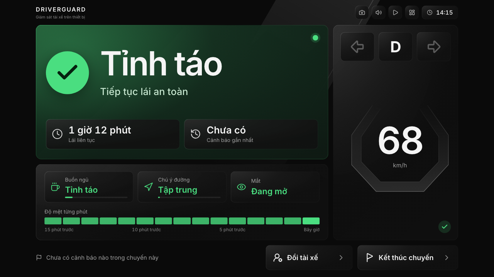
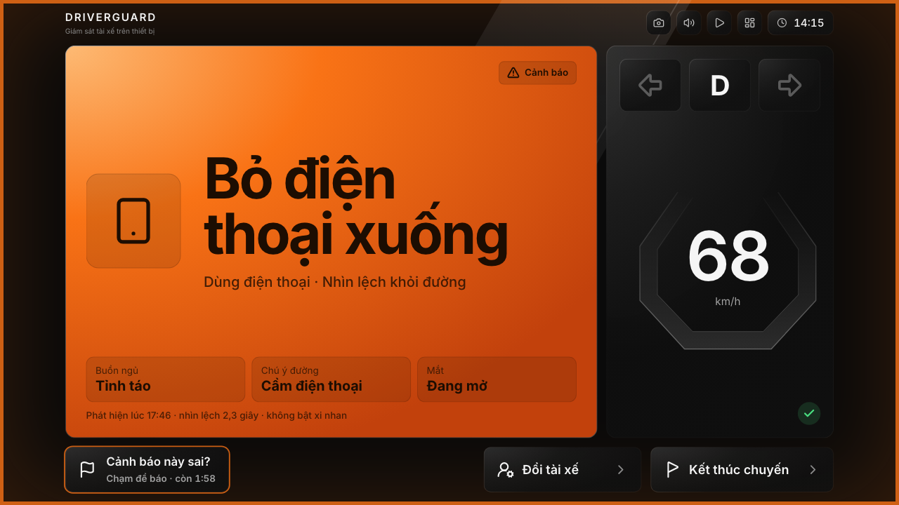
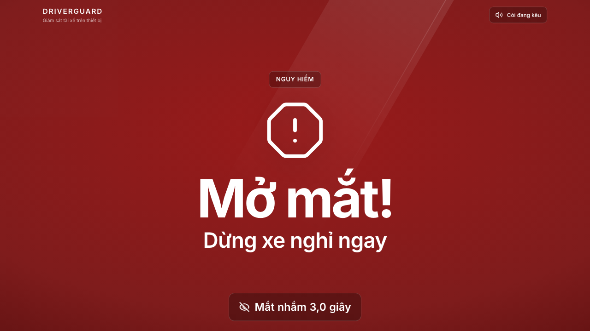
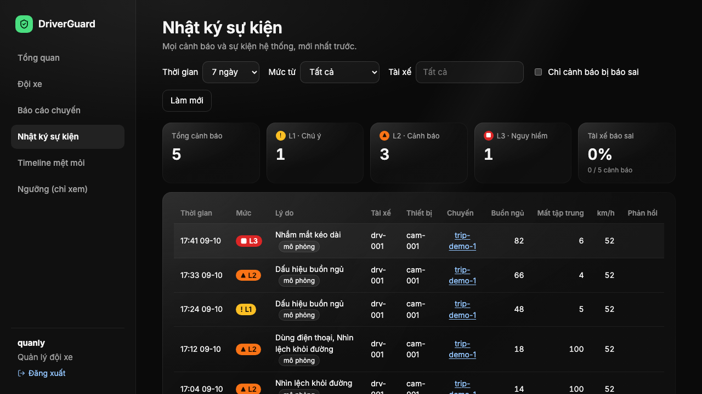
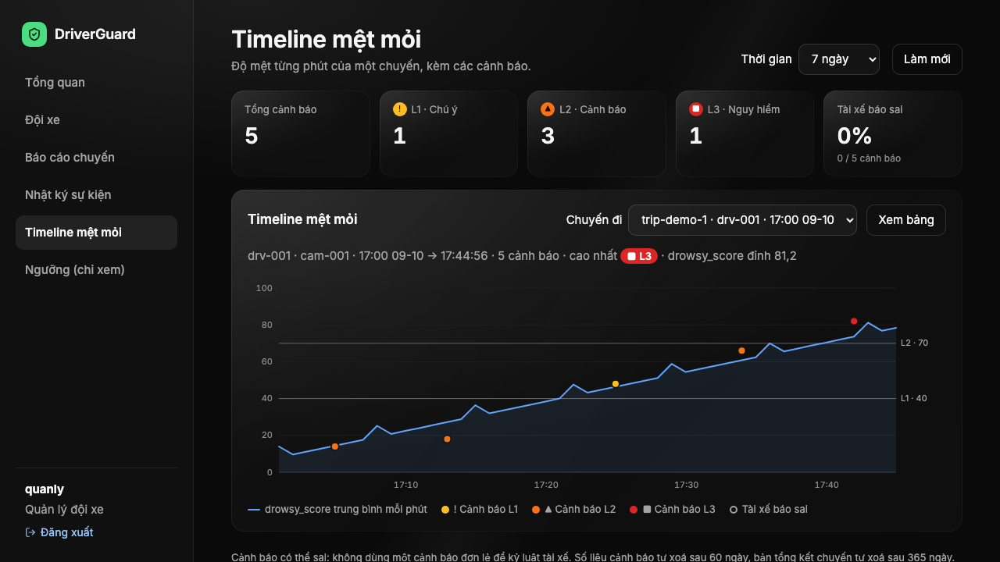
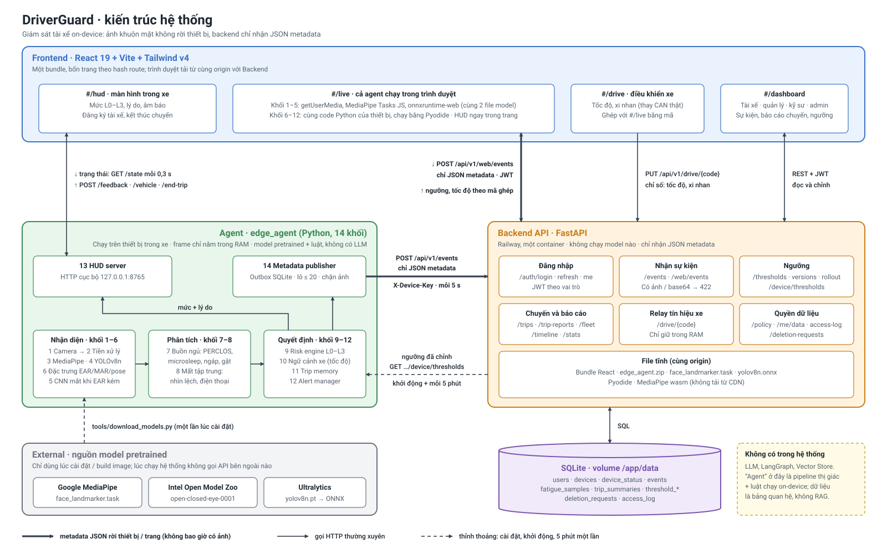
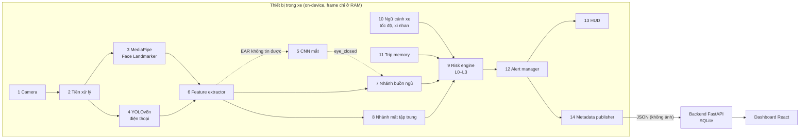

# DriverGuard

Hệ thống giám sát tài xế (Driver Monitoring System) chạy **ngay trên thiết bị**: camera nhìn tài xế,
phát hiện **buồn ngủ** (nhắm mắt lâu, PERCLOS, ngáp, gục đầu, chớp chậm) và **mất tập trung** (nhìn khỏi
đường, điện thoại), cảnh báo theo 4 mức L0–L3, và chỉ gửi **metadata JSON** lên máy chủ. Ảnh khuôn mặt
không bao giờ được ghi ra đĩa hay gửi đi; chỉ dùng model pretrained (MediaPipe, YOLOv8n, CNN mắt Intel).

| | |
|---|---|
| **Phiên bản** | v2.2 (deploy 02/10/2026, các mốc M0–M31) |
| **Live URL** | Ba service đang chạy song song trên Railway (kiểm 09/10/2026 bằng `/openapi.json`): v3 (deploy M66, 08/10) ở https://driveguard-production-5093.up.railway.app; v2.2 ở https://driveguard-v2-production.up.railway.app; v1.1 ở https://driveguard-production-6b83.up.railway.app. Các liên kết trong README này trỏ tới bản v2.2: dashboard `/#/dashboard`, giám sát trên trình duyệt `/#/live`, điều khiển xe `/#/drive?code=…`, API `/health`, Swagger `/docs` |
| **Sản phẩm cuối** | Thiết kế: app APK chạy trên hub gắn trên xe, bọc chính code web. Chưa có code APK; đóng gói APK đã bỏ ngày 08/10 (không còn hub và xe thật, [danh sách](docs/improvements.md#bo-hub)). Đầu ra hiện tại là bản web mô phỏng |
| **Khoá học** | AI20K Build Phase, VinUni (repo sinh từ template của khoá, xem [mục Template](#template-khoá-ai20k)) |

## Ảnh chụp màn hình

| HUD: bình thường (L0) | HUD: cầm điện thoại (L2) | HUD: ngủ gật (L3) |
|---|---|---|
|  |  |  |

| Dashboard: nhật ký sự kiện | Dashboard: timeline mệt mỏi |
|---|---|
|  |  |

Ảnh HUD chụp ở trang `#/hud-preview` (trạng thái cố định, đã ẩn thanh chọn kịch bản). Ảnh dashboard chụp trên một
database tạm với một chuyến **mô phỏng** (các dòng mang nhãn "mô phỏng"), không phải số liệu lái thật. Không ảnh nào
có khuôn mặt.

## Mục lục

1. [Vấn đề và giải pháp](#vấn-đề-và-giải-pháp)
2. [Người dùng và tính năng](#người-dùng-và-tính-năng)
3. [Kiến trúc](#kiến-trúc)
4. [Tech stack](#tech-stack)
5. [Quick start](#quick-start)
6. [Biến môi trường](#biến-môi-trường)
7. [API và ví dụ gọi](#api-và-ví-dụ-gọi)
8. [Kiểm thử và đánh giá](#kiểm-thử-và-đánh-giá)
9. [Cấu trúc thư mục](#cấu-trúc-thư-mục)
10. [Deliverables](#deliverables)
11. [Team](#team)
12. [AI usage logging](#ai-usage-logging)

## Vấn đề và giải pháp

**Vấn đề.** Tài xế buồn ngủ hoặc mất tập trung (nhìn điện thoại, nhìn khỏi đường vài giây) là nguyên nhân
lớn của tai nạn. Hệ thống cảnh báo hiện có thường **báo sai nhiều** nên tài xế tắt đi, **không nói rõ khi
không quan sát được** (mất mặt, mất camera), và nhiều giải pháp gửi video khuôn mặt lên cloud.

**Giải pháp.** DriverGuard dùng camera có sẵn, chạy toàn bộ xử lý trên thiết bị (≥ 15 FPS, không cần GPU):

- Phát hiện từ landmark khuôn mặt (EAR, MAR, góc đầu), CNN trạng thái mắt và YOLO điện thoại, rồi tính
  `drowsy_score`, `distraction_score` → mức **L0–L3**.
- **Chống cảnh báo sai** ngang với độ chính xác: lọc theo thời gian, cooldown, theo tốc độ và xi nhan
  (xe đứng yên thì không cảnh báo; xi nhan thì cho nhìn ngang lâu hơn), đăng ký khuôn mặt để có mốc riêng
  của từng tài xế, nút "Cảnh báo sai" để kỹ sư chỉnh ngưỡng.
- **Trung thực khi không giám sát được**: mất mặt, mất camera, mất tín hiệu xe, lỗi / chậm xử lý đều hiện
  rõ trên HUD kèm âm báo.
- **Riêng tư**: frame chỉ nằm trong RAM; backend từ chối mọi dữ liệu giống ảnh / base64.

## Người dùng và tính năng

| Vai trò | Dùng gì | Làm được gì |
|---|---|---|
| Tài xế (`driver`) | HUD trong xe `#/hud` / `#/live` | Nhận cảnh báo màu + chữ + âm thanh, đăng ký khuôn mặt (~10 s, khi xe dừng), báo cảnh báo sai, xem tổng kết cuối chuyến, chỉ thấy dữ liệu của mình |
| Kỹ sư an toàn (`engineer`) | Dashboard | Nhật ký sự kiện, timeline mệt mỏi, báo cáo chuyến, **chỉnh ngưỡng** (lưu theo phiên bản, thiết bị tải khi khởi động) |
| Quản lý đội xe (`manager`) | Dashboard | Xem toàn đội, báo cáo chuyến chưa ai xem, ngưỡng chỉ đọc |
| Quản trị (`admin`) | Dashboard / CLI | Tạo tài khoản, tạo thiết bị (khóa thiết bị) |

**Một chuyến đi:** xe dừng → HUD hỏi đồng ý rồi hướng dẫn đăng ký khuôn mặt → lái, hệ thống cảnh báo
theo mức (âm thanh luôn bật) → tài xế bấm "Kết thúc chuyến" → bảng tổng kết cho tài xế, quản lý / kỹ sư
xem ở tab "Báo cáo chuyến đi" trên dashboard.

| Mức | Khi nào (ví dụ) | Cảnh báo |
|---|---|---|
| L0 | Bình thường | Không |
| L1 | `drowsy_score` bắt đầu cao | Nhắc nhẹ trên HUD |
| L2 | Cầm điện thoại, nhìn khỏi đường lâu, buồn ngủ rõ | Màu cam + âm báo |
| L3 | Microsleep (nhắm mắt ≥ 1,5 s khi xe chạy) | Đỏ toàn màn hình, còi lặp tới khi mở mắt |

Chi tiết ngưỡng ở [`config/thresholds.yaml`](config/thresholds.yaml) và [HowToUse.md mục 2](HowToUse.md#2-chức-năng).

## Kiến trúc



Hệ thống có năm phần. **Agent** (`edge_agent/`, Python) chạy trên thiết bị trong xe: đọc camera, nhận diện, chấm
mức rủi ro L0–L3 và phát cảnh báo; frame chỉ nằm trong RAM. **Frontend** (React) có bốn trang: `#/hud` hỏi agent
qua HTTP cục bộ, `#/live` chạy cả agent ngay trong trình duyệt, `#/drive` giả lập tốc độ / xi nhan, `#/dashboard`
cho tài xế, quản lý, kỹ sư. **Backend API** (FastAPI trên Railway) chỉ nhận JSON metadata, từ chối mọi thứ giống ảnh
(HTTP 422), và trả ngưỡng đã chỉnh về cho agent. **Database** là SQLite. **External**: ba nguồn model pretrained, chỉ
dùng lúc cài đặt; lúc chạy không gọi API bên ngoài nào. Hệ thống không có LLM, LangGraph hay Vector Store: "agent" ở
đây là pipeline thị giác + luật chạy on-device (code LangGraph trong `src/` là mẫu của khoá học, DriverGuard không dùng).

Bản PNG: [docs/diagrams/png/architecture.png](docs/diagrams/png/architecture.png); hình sinh từ
[docs/diagrams/build_architecture.py](docs/diagrams/build_architecture.py).

Bên trong agent, 14 khối chạy theo thứ tự, mỗi khối là một module trong `edge_agent/`, giao tiếp qua dataclass:



Cùng một logic Python chạy hai cách: trên thiết bị (`python -m edge_agent.main`) và trong trình duyệt
(`#/live`, Pyodide + MediaPipe Web + onnxruntime-web). Sơ đồ đầy đủ (luồng dữ liệu, trình tự một cảnh báo,
deployment, phần thêm ở v2) ở [docs/architecture_diagram.md](docs/architecture_diagram.md).

## Tech stack

| Lớp | Công nghệ |
|---|---|
| Thị giác (pretrained) | MediaPipe Face Landmarker 0.10, YOLOv8n ONNX (COCO, lớp điện thoại), CNN mắt đóng / mở (Intel Open Model Zoo, ONNX) |
| Edge agent | Python 3.11+, OpenCV, NumPy, onnxruntime, PyYAML |
| Backend | FastAPI, Uvicorn, Pydantic 2, SQLite, JWT (PyJWT), mật khẩu scrypt |
| Frontend | React 19, TypeScript 5.9, Vite 8, Tailwind CSS 4; `#/live`: Pyodide, `@mediapipe/tasks-vision`, `onnxruntime-web` |
| Kiểm thử | pytest, Vitest, Playwright (e2e), ruff |
| Deploy | Docker (`Dockerfile.railway`), Railway; gói cài edge agent cho máy trong xe (`packaging/edge/`) |

DriverGuard **không dùng LLM**: phần LangGraph / OpenAI trong `src/` là code mẫu của template khoá học.

## Quick start

**Cần:** Python ≥ 3.11 (khuyên 3.12), Node.js ≥ 20.19, [uv](https://docs.astral.sh/uv/) (hoặc pip),
một webcam. Lệnh dưới đây cho macOS / Linux; Windows (PowerShell) xem [HowToUse.md mục 6–7](HowToUse.md#6-cài-đặt).

Chỉ muốn xem thử: mở [Live URL](https://driveguard-v2-production.up.railway.app/#/live), không cần cài gì.

### 1. Cài môi trường và model

```bash
git clone https://github.com/AI20K-Build-Phase-Cohort-4/P-135.git && cd P-135
uv venv -p 3.12 --seed .venv && source .venv/bin/activate     # hoặc: make venv
uv pip install -r requirements-dev.txt
python tools/download_models.py        # face_landmarker.task + open_closed_eye.onnx vào models/
```

`yolov8n.onnx` (phát hiện điện thoại) cần export bằng `ultralytics` + `torch` (~1 GB), nên làm một lần
trong venv tạm (HowToUse [mục 6.2](HowToUse.md#62-model-bắt-buộc)). Thiếu file này hệ thống vẫn chạy, chỉ
tắt phát hiện điện thoại.

### 2. Biến môi trường

```bash
cp .env.example .env
python -c "import secrets; print(secrets.token_urlsafe(48))"   # dán vào DG_JWT_SECRET trong .env
```

### 3. Khởi tạo backend (một lần)

```bash
python -m backend.manage create-user admin --role admin
python -m backend.manage create-user kysu  --role engineer
python -m backend.manage create-user boss  --role manager
python -m backend.manage create-user an    --role driver --driver-id drv-001
python -m backend.manage create-device cam-001 --driver-id drv-001   # in khóa thiết bị MỘT lần → DG_DEVICE_KEY
```

Lệnh sẽ hỏi mật khẩu (≥ 8 ký tự) để mật khẩu không nằm trong lịch sử shell.

### 4. Chạy (4 terminal)

```bash
# 1. Backend: API ở :8100, Swagger http://localhost:8100/docs
uvicorn backend.app:app --port 8100                      # hoặc: make run

# 2. Edge agent: camera 0, HUD server 127.0.0.1:8765, gửi metadata lên backend
python -m edge_agent.main --source 0 --backend http://localhost:8100 --device-id cam-001

# 3. Mô phỏng tốc độ / xi nhan (thay CAN của xe): w/s tăng giảm tốc, a/d xi nhan, space dừng
python tools/drive_sim.py

# 4. Frontend
cd frontend && npm install && npm run dev
```

| Trang | URL |
|---|---|
| HUD trong xe (đọc edge agent, có nút "Chạy mô phỏng" khi không có agent) | http://localhost:5173/#/hud |
| Giám sát ngay trong trình duyệt (cần `npm run prepare-live` một lần) | http://localhost:5173/#/live |
| Dashboard (đăng nhập bằng tài khoản ở bước 3) | http://localhost:5173/#/dashboard |
| Xem trước các trạng thái HUD | http://localhost:5173/#/hud-preview |

Chỉ muốn xem camera và chỉ số, không cần backend: `python tools/debug_view.py --source 0`.
Kịch bản demo gợi ý: [HowToUse.md mục 7.4](HowToUse.md#74-kịch-bản-demo-gợi-ý).

### 5. Chạy bằng Docker (backend + web trong một image)

[`Dockerfile.railway`](Dockerfile.railway) là image của bản deploy: backend FastAPI, dashboard, HUD và `#/live` cùng một
origin. Server không chạy model; trình duyệt tải model rồi tự chạy. Cần có sẵn `models/face_landmarker.task` và
`models/yolov8n.onnx` (bước 1) trước khi build.

```bash
docker build -f Dockerfile.railway -t driverguard .
docker run -d --name driverguard -p 8000:8000 \
  -e DG_JWT_SECRET="$(python -c 'import secrets; print(secrets.token_urlsafe(48))')" \
  -v driverguard-data:/app/data driverguard

# Tạo tài khoản trong container (hỏi mật khẩu), rồi mở http://localhost:8000
docker exec -it driverguard python -m backend.manage create-user admin --role admin
```

Volume `driverguard-data` giữ file SQLite qua các lần chạy lại. `#/live` cần camera nên chỉ chạy ở `localhost` hoặc
HTTPS. Edge agent (đọc camera, chạy model) không nằm trong image này: chạy như bước 4 và trỏ `--backend
http://localhost:8000`. `Dockerfile` và `docker-compose.yml` ở gốc repo là app mẫu của khoá học, không phải DriverGuard
(xem [mục Template](#template-khoá-ai20k)). Deploy lên Railway: [docs/deploy-railway.md](docs/deploy-railway.md).

## Biến môi trường

Backend đọc `.env` ở thư mục gốc (tiền tố `DG_`); frontend đọc `frontend/.env.local`
(mẫu ở [`frontend/.env.example`](frontend/.env.example)). Không commit `.env`.

| Biến | Dùng ở | Mặc định | Ý nghĩa |
|---|---|---|---|
| `DG_JWT_SECRET` | backend | (trống) | **Bắt buộc khi chạy thật.** Chuỗi ngẫu nhiên dài để ký token đăng nhập |
| `DG_DB_PATH` | backend | `data/driverguard.db` | File SQLite |
| `DG_TOKEN_TTL_MIN` | backend | `60` | Thời hạn đăng nhập (phút, 1–1440) |
| `DG_CORS_ORIGINS` | backend | `http://localhost:3000,http://localhost:5173` | Origin được gọi API, cách nhau bằng dấu phẩy |
| `DG_MAX_BODY_BYTES` | backend | `262144` | Giới hạn kích thước một request (byte) |
| `DG_DEVICE_OFFLINE_AFTER_S` | backend | `90` | Thiết bị im lặng quá số giây này thì tab "Đội xe" hiện "Mất liên lạc" (nhịp "còn sống" mỗi 30 s) |
| `DG_CLOCK_SKEW_WARN_S` | backend | `120` | Giờ của nhịp "còn sống" lệch giờ máy chủ quá số giây này thì tab "Đội xe" đánh dấu đồng hồ thiết bị sai. Thứ tự nhịp, mục "cần chú ý ngay" và thời hạn tự xoá luôn tính theo giờ máy chủ (M82) |
| `DG_RETENTION_EVENTS_DAYS` | backend | `60` | Số ngày giữ cảnh báo, sự kiện và mẫu theo phút trước khi tự xoá (0 = không tự xoá). Xem [docs/data-policy.md](docs/data-policy.md) |
| `DG_RETENTION_SUMMARIES_DAYS` | backend | `365` | Số ngày giữ bản tổng kết chuyến trước khi tự xoá (0 = không tự xoá) |
| `DG_STATIC_DIR` | `deploy/railway_app.py` | `static` | Thư mục dashboard đã build, phục vụ cùng origin với API (Railway) |
| `DG_DEVICE_KEY` | edge agent | (trống) | Khóa thiết bị từ `create-device`; thiếu thì agent chạy offline, không gửi metadata (hoặc truyền `--device-key`) |
| `VITE_API_URL` | frontend | `http://localhost:8100` | Địa chỉ backend |
| `VITE_EDGE_URL` | frontend | `http://127.0.0.1:8765` | HUD server của edge agent (`--hud-port`) |
| `AI_LOG_SERVER`, `AI_LOG_API_KEY`, `AI_LOG_DIR` | hook của khoá học | xem `.env.example` | Gửi log dùng AI lên server chấm ([mục AI usage logging](#ai-usage-logging)) |

Các biến còn lại trong `.env.example` (`OPENAI_API_KEY`, `DATABASE_URL`, `CHROMA_PERSIST_DIR`,
`LANGCHAIN_*`, `APP_*`) chỉ dành cho code mẫu `src/` của template, DriverGuard không dùng.

Tùy chọn dòng lệnh của edge agent (`--scenario`, `--sim-url`, `--hud-port`, `--no-window`, `--no-phone`…)
ở [HowToUse.md mục 7.3](HowToUse.md#73-toàn-bộ-hệ-thống-4-terminal).

## API và ví dụ gọi

Swagger đầy đủ: http://localhost:8100/docs (local) hoặc https://driveguard-v2-production.up.railway.app/docs.

| Endpoint | Ai gọi | Mục đích |
|---|---|---|
| `GET /health` | ai cũng được | Kiểm tra server |
| `POST /auth/login`, `GET /auth/me` | người dùng | Đăng nhập (JWT), xem mình là ai |
| `POST /api/v1/events` | thiết bị (`X-Device-Key`) | Gửi lô sự kiện / phản hồi / mẫu timeline / tổng kết chuyến / nhịp "còn sống" |
| `POST /api/v1/web/events` | người dùng (`#/live`) | Như trên, từ trình duyệt |
| `GET /api/v1/events`, `/trips`, `/timeline`, `/stats` | mọi vai trò (tài xế chỉ thấy của mình) | Nhật ký, chuyến, timeline mệt mỏi, thống kê |
| `GET /api/v1/policy` | không cần đăng nhập | Thời hạn lưu dữ liệu đang cấu hình (hai con số) |
| `GET /api/v1/fleet` | mọi vai trò (tài xế chỉ thấy xe của mình) | Tổng quan đội xe: đang hoạt động / mất liên lạc / đã kết thúc chuyến, cảnh báo trong khoảng `since`–`until` |
| `GET /api/v1/trip-reports[/{device}/{trip}]`, `POST …/review` | mọi vai trò / quản lý, kỹ sư, admin | Báo cáo cuối chuyến, đánh dấu đã xem |
| `GET`, `PUT /api/v1/thresholds` | xem: quản lý, kỹ sư, admin; sửa: kỹ sư, admin | Ngưỡng theo phiên bản |
| `GET /api/v1/device/thresholds` | thiết bị | Thiết bị tải ngưỡng khi khởi động |
| `GET`, `POST /api/v1/users`, `POST /api/v1/devices` | admin | Tạo tài khoản, thiết bị |
| `PUT`, `GET /api/v1/drive/{code}` | trang `#/drive` / `#/live` | Tốc độ + xi nhan theo mã ghép 6 ký tự (chỉ trong RAM) |

Ví dụ với backend local (đổi `BASE` thành Live URL để gọi bản deploy):

```bash
BASE=http://localhost:8100

# 1. Kiểm tra server
curl $BASE/health
# {"status":"ok"}

# 2. Đăng nhập, lấy token
TOKEN=$(curl -s -X POST $BASE/auth/login -H 'Content-Type: application/json' \
  -d '{"username":"kysu","password":"<mật khẩu>"}' | python -c 'import sys,json;print(json.load(sys.stdin)["access_token"])')

# 3. Cảnh báo từ L2 trở lên, mới nhất trước
curl -s "$BASE/api/v1/events?min_level=2&limit=5" -H "Authorization: Bearer $TOKEN"

# 4. Chỉ những cảnh báo tài xế báo sai, của một tài xế
curl -s "$BASE/api/v1/events?false_alarm_only=true&driver_id=drv-001" -H "Authorization: Bearer $TOKEN"

# 5. Các chuyến gần đây và báo cáo chưa ai xem
curl -s "$BASE/api/v1/trips?limit=10" -H "Authorization: Bearer $TOKEN"
curl -s "$BASE/api/v1/trip-reports?unreviewed_only=true" -H "Authorization: Bearer $TOKEN"

# 6. Kỹ sư đổi ngưỡng (lưu thành phiên bản mới; ngoài khoảng cho phép trả 422)
curl -s -X PUT $BASE/api/v1/thresholds -H "Authorization: Bearer $TOKEN" -H 'Content-Type: application/json' \
  -d '{"values":{"risk.drowsy.l1":45}}'

# 7. Thiết bị gửi một cảnh báo (bình thường edge agent tự gửi; chỉ là JSON, không có ảnh)
curl -s -X POST $BASE/api/v1/events -H "X-Device-Key: $DG_DEVICE_KEY" -H 'Content-Type: application/json' -d '{
  "device_id": "cam-001",
  "events": [{
    "event_id": "3f6c1a52-8a4e-4c1e-9d0b-2a7f5e1c9b10",
    "ts": "2026-10-03T08:30:00+07:00",
    "trip_id": "trip-demo-1",
    "type": "drowsiness",
    "level": 3,
    "reasons": ["microsleep"],
    "drowsy_score": 82,
    "distraction_score": 10,
    "speed_kmh": 50,
    "metrics": {"closed_duration": 2.1, "perclos_60s": 0.31}
  }]
}'

# 8. Điều khiển xe từ xa theo mã ghép mà #/live hiện ra
curl -s -X PUT $BASE/api/v1/drive/AB12CD -H 'Content-Type: application/json' -d '{"speed_kmh":50,"turn_signal":"left"}'
curl -s $BASE/api/v1/drive/AB12CD
# {"speed_kmh":50.0,"turn_signal":"left","age_s":0.4}
```

## Kiểm thử và đánh giá

```bash
ruff check edge_agent/ backend/ tools/ tests/ && ruff format --check edge_agent/ backend/ tools/ tests/
pytest tests/                                            # hoặc: make test
cd frontend && npm run typecheck && npm test && npm run e2e
```

Logic theo thời gian (khối 7–12) được test bằng chuỗi số giả, không cần video. Đánh giá độ chính xác và
tốc độ:

| Gì | Kết quả | Nhận định | Chi tiết |
|---|---|---|---|
| CNN mắt nhắm (MRL Eye, 4000 ảnh) | Accuracy 99,4%, FPR 0,2% | Lạc quan: CNN được học trên chính MRL Eye. Trên ảnh khác (yawn-eye) accuracy 88,1% | [eval/results/report.md](eval/results/report.md) |
| Ngáp theo MAR (yawn-eye, test) | Accuracy 91,6%, precision 100% | Đo trên ảnh đơn, 215 ảnh. Trên video (FL3D) bắt được 76/99 lần ngáp | [eval/results/report.md](eval/results/report.md) |
| Ngủ gật ≥ 1,5 s đạt L3 (FL3D, video lái đêm, diễn) | 75/95 (78,9%) | **Chưa đạt** mục tiêu ≥ 90% của PRD | [eval/results/report.md](eval/results/report.md) |
| Cảnh báo sai mỗi giờ (FL3D / YawDD / SUST) | 2,3–8,5 / giờ tuỳ bộ và mức, CI 95% rộng | **Chưa đạt** mục tiêu ≤ 1,0 / giờ; chưa có giờ lái thật có nhãn | [eval/results/report.md](eval/results/report.md) |
| Tốc độ vòng lặp chính (Mac ARM, CPU) | ~146 FPS, MediaPipe ~5,7 ms/frame | Đạt ≥ 15 FPS **trên máy dev**; chưa đo trên hub gắn trên xe | [eval/results/benchmark.md](eval/results/benchmark.md) |
| Chạy 10 phút theo nhịp camera, container 4 CPU / 4 GB (`simulated`) | 29,9 FPS, p95 11,1 ms, CPU 93 % của một nhân, RAM 597 MB | Cận trên cho bo mạch 4 nhân: cùng CPU của máy dev, chỉ ít nhân hơn. Không phải số đo thiết bị | [eval/results/benchmark_simulated.md](eval/results/benchmark_simulated.md) |

Toàn bộ tiêu chí để chạy thử trên xe thật và trạng thái từng tiêu chí: [docs/pilot-readiness.md](docs/pilot-readiness.md).

Công cụ: `tools/eval.py` (video có nhãn theo thời gian), `tools/dataset.py` (dataset Kaggle),
`tools/seq_eval.py` (nhãn theo frame / clip), `tools/benchmark.py` (FPS; `--duration` chạy dài đo CPU / RAM),
`tools/record_trace.py` (tự ghi số từ camera kèm nhãn bấm phím, không lưu ảnh), `tools/trace_studies.py`
(đo offline trên trace sẵn có), `tools/edge_sim.py` (chạy trong container giới hạn kiểu Jetson, `simulated`). Cách chạy ở
[HowToUse.md mục 9](HowToUse.md#9-đánh-giá-và-benchmark).

## Cấu trúc thư mục

```
P-135/
├── edge_agent/          14 khối on-device (camera → … → HUD server, metadata publisher), runtime chung, web bridge
├── backend/             FastAPI: auth, sự kiện, chuyến, báo cáo, ngưỡng, quản trị (SQLite)
├── frontend/
│   ├── src/hud/         HUD trong xe, #/hud-preview
│   ├── src/live/        #/live: cả agent chạy trong trình duyệt
│   ├── src/drive/       #/drive: giả lập tốc độ / xi nhan
│   ├── src/dashboard/   dashboard theo vai trò
│   └── e2e/             test Playwright
├── config/              thresholds.yaml (mọi ngưỡng), kịch bản CAN, drive_sim.yaml
├── tools/               tải model, mô phỏng lái xe, eval, dataset, benchmark, debug view
├── tests/               pytest cho edge agent, backend, tools
├── models/              model đã tải (không commit)
├── eval/results/        kết quả đánh giá và benchmark
├── deploy/              app Railway (API + dashboard cùng origin), kèm Dockerfile.railway, railway.json
├── packaging/edge/      gói cài và chạy edge agent trên máy trong xe
├── docs/                PRD, kiến trúc, roadmap, release notes, FMEA, nhật ký công việc, screenshots/
└── src/                 code mẫu của template khoá học (LangGraph), DriverGuard không dùng
```

Bảng khối ↔ file: [HowToUse.md mục 3.2](HowToUse.md#32-khối--file).

## Deliverables

| # | Deliverable | Ở đâu | Trạng thái |
|---|---|---|---|
| 1 | Source code | `edge_agent/`, `backend/`, `frontend/`, `tools/`, `config/` | ✅ |
| 2 | README | File này (ảnh ở [docs/screenshots/](docs/screenshots/)) + [HowToUse.md](HowToUse.md) | ✅ |
| 3 | Architecture diagram | [docs/architecture_diagram.md](docs/architecture_diagram.md) | ✅ |
| 4 | AI logs | `.ai-log/`, gửi tự động lên server chấm khi `git push` | ✅ |
| 5 | Live URL | https://driveguard-v2-production.up.railway.app | ✅ |
| 6 | Video demo | `presentation/` | Chưa có |
| 7 | Pitch deck | `presentation/` | Chưa có |
| 8 | Development journal | [docs/JOURNAL.md](docs/JOURNAL.md): mỗi ngày một mục (quyết định, khó khăn, bài học) | ✅ |
| 9 | Worklog | [docs/WORKLOG.md](docs/WORKLOG.md): bảng theo ngày và lịch sử commit; chi tiết ở [docs/worklog/](docs/worklog/) | ✅ |
| 10 | Evaluation evidence | [eval/results/](eval/results/) | ✅ |

Tài liệu khác: [docs/PRD.md](docs/PRD.md) (yêu cầu sản phẩm), [docs/release-v2.md](docs/release-v2.md)
(thêm / sửa / bỏ ở v2, giới hạn đã biết), [docs/release-v3.md](docs/release-v3.md) (M32–M69, từ 05/10), [docs/release-v4.md](docs/release-v4.md) (audit 08/10 và các việc
làm theo nó, từ M70, chưa deploy),
[docs/pilot-readiness.md](docs/pilot-readiness.md) (còn thiếu gì để chạy thử trên xe thật),
[docs/data-policy.md](docs/data-policy.md) (thu dữ liệu gì, ai xem, giữ bao lâu), [docs/safety-fmea.md](docs/safety-fmea.md) (những lúc hệ thống
không cảnh báo được), [docs/improvements.md](docs/improvements.md) (việc chưa làm),
[CLAUDE.md](CLAUDE.md) (ràng buộc và quy ước).

## Team

Team DriverGuard (4 người), AI20K Build Phase Cohort 4, VinUni:

| Thành viên | GitHub | Vai trò (theo [docs/WORKLOG.md](docs/WORKLOG.md)) |
|---|---|---|
| Đoàn Anh Quân | [@DQQuan-VinAI](https://github.com/DQQuan-VinAI) | Edge agent và chống báo sai, đánh giá trên dataset, bản web `#/live`, backend, audit, deploy Railway, tài liệu |
| Hoàng Đức Dũng | [@hddung-vinai](https://github.com/hddung-vinai) | Dựng pipeline 14 khối, backend và dashboard ban đầu (M0–M7); giao diện Version 4, giọng nói tiếng Việt, deploy tự động (M57–M66) |
| Nguyễn Phúc Huy | [@Yuhnguyn](https://github.com/Yuhnguyn) | PRD, sơ đồ Use Case và User Flow |
| Ngô Hoàng Thụy Khuê | [@kelsingo](https://github.com/kelsingo) | PRD gate 1 |

## AI usage logging

Yêu cầu của khoá học: prompt dùng AI được ghi vào `.ai-log/session.jsonl` và tự gửi lên server chấm ở
bước git pre-push. Cài một lần sau khi clone, rồi điền `AI_LOG_API_KEY` (tạo ở
[dashboard Phoenix](https://phoenix.note.transformerlabs.ai/api-keys)) vào `.env`:

```bash
bash scripts/setup_hooks.sh                                      # Linux / macOS / Git Bash
powershell -ExecutionPolicy Bypass -File scripts\setup_hooks.ps1 # Windows PowerShell
```

| Công cụ | Cấu hình | Thời điểm ghi |
|---|---|---|
| Claude Code | `.claude/settings.json` | mỗi prompt (`UserPromptSubmit`) |
| Cursor | `.cursor/hooks.json` | mỗi prompt và khi dừng |
| OpenAI Codex CLI | `.codex/hooks.json` | mỗi prompt và khi dừng |
| Gemini CLI | `.gemini/settings.json` | mỗi lượt agent chạy |
| GitHub Copilot | `.github/hooks/hooks.json` | mỗi prompt và cuối session |
| Antigravity IDE | `.agents/hooks.json` | mỗi prompt, kèm lần quét lại lúc `git push` |

Dùng ChatGPT hay công cụ web khác thì ghi thủ công:

```bash
bash scripts/_pyrun.sh scripts/log_manual.py --tool chatgpt --prompt "What you asked"
```

## Template khoá AI20K

Repo được sinh từ template chính thức của AI20K Build Phase. Những phần sau là của template, giữ lại theo
yêu cầu khoá học, DriverGuard không dùng:

- `src/` (LangGraph agent + FastAPI mẫu), `requirements-template.txt`; khi chưa cài, `tests/test_agents`
  và `tests/test_api` tự bỏ qua.
- `Dockerfile` / `docker-compose.yml` chạy app mẫu `src.main:app`. Bản deploy DriverGuard dùng
  `Dockerfile.railway`; `Dockerfile.edge` (và dịch vụ `edge` trong compose, không bật mặc định) chạy edge
  agent trong container có giới hạn tài nguyên để đo `simulated`.
- Technical Guidebook 10 chương ở `docs/guide/` (bản online:
  <https://phoenix.note.transformerlabs.ai/technical-book>), khung `README_boilerplate.md`.

## Đóng góp và license

Đọc [CONTRIBUTING.md](CONTRIBUTING.md) trước khi mở PR (Conventional Commits, chạy ruff + pytest). Mọi
thay đổi trong `docs/guide/` cần review của
[@AI20K-Build-Phase/book-maintainers](https://github.com/orgs/AI20K-Build-Phase/teams/book-maintainers).
Báo lỗ hổng bảo mật theo [SECURITY.md](SECURITY.md), đừng mở public issue.

[MIT](LICENSE): dùng tự do cho mục đích giáo dục.
