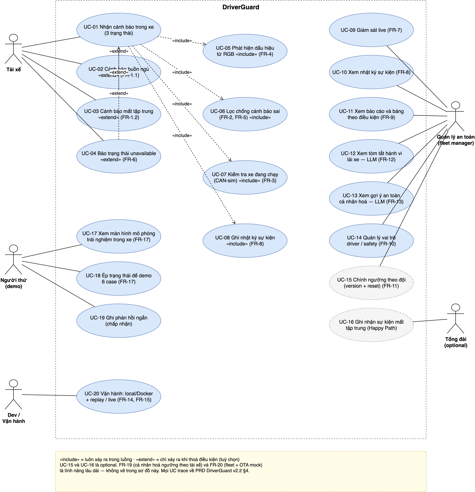
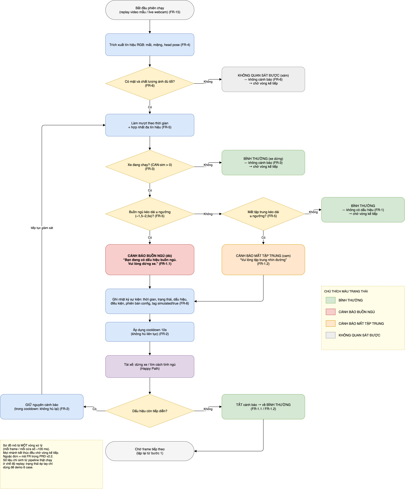

# DriverGuard — PRD (v2.2, khung SẢN PHẨM)

| | |
|---|---|
| Phiên bản | 2.2 (product-first, đo offline) |
| Ngày | 23/09/2026 |
| Sở hữu | Team DriverGuard (4 người) — AI in Action, VinUni |
| Trạng thái | Draft chờ duyệt |
| Thay đổi so với v2.1 | **Bỏ pilot người thật.** Thay bằng (a) *chế độ mô phỏng trải nghiệm trong xe* để demo + kiểm tra hiểu cảnh báo, và (b) *đo offline trên clip có nhãn* cho mọi chỉ số impact. §7 rút từ 5 bậc xuống 3 bậc. Thêm **hard rule phân tách mô phỏng**. Sửa lỗi đánh số FR. |
| Thay đổi so với v1.0 | Kết quả chính là **sản phẩm chạy được + impact đo offline**; so sánh B0/M1 hạ xuống kiểm tra kỹ thuật nội bộ. |

## 1. Tóm tắt sản phẩm

DriverGuard dùng **camera có sẵn** để phát hiện dấu hiệu mất tỉnh táo/mất tập trung của tài xế, **cảnh báo đúng lúc và ít cảnh báo sai**, và cho quản lý an toàn một **dashboard nhật ký + báo cáo**. Điểm khác biệt không nằm ở model (model có sẵn), mà ở **trải nghiệm ít cảnh báo sai + trung thực khi không quan sát được**.

Phạm vi kiểm chứng của v2.2: **không có pilot với người lái**. Toàn bộ chỉ số impact sinh từ **pipeline thật chạy ở chế độ replay trên clip có nhãn**; phần "người thật" chỉ còn **một buổi 3 phút/người** để kiểm tra người xem có hiểu 3 trạng thái không.

## 2. Người dùng & nhu cầu

| Vai trò | Nhu cầu | Câu chuyện người dùng |
|---|---|---|
| Tài xế (user) | Được nhắc khi thật sự mệt, không bị làm phiền | "Khi tôi buồn ngủ, tôi muốn được nhắc kịp, nhưng đừng báo động khi tôi vẫn có thể tập trung." |
| Quản lý an toàn (buyer) | Thấy được sự kiện theo chuyến/tài xế | "Tôi muốn xem lại buổi chạy và biết tài xế nào cần huấn luyện, tạo hệ thống cá nhân hoá cảnh báo cho từng tài xế." |

> Ghi chú v2.2: nguồn dữ liệu cho nhật ký của quản lý là **phiên replay có nhãn** (không phải chuyến chạy đường thật).

## 3. Mục tiêu & phi mục tiêu

**Mục tiêu sản phẩm**
- P-1: Tài xế được cảnh báo với **ít cảnh báo sai**.
- P-2: Sự kiện mệt mỏi được phát hiện kịp (**time-to-alert p95 ≤3s**).
- P-3: Hệ thống **trung thực**: khi không quan sát/dự đoán được thì nhận biết và báo lỗi, không đoán bừa.
- P-4: Quản lý có dashboard + nhật ký dùng được.
- P-5: Có **chế độ mô phỏng trải nghiệm trong xe** (3 trạng thái cảnh báo, đúng tỉ lệ thiết bị) để demo 6 case và để kiểm tra người xem có hiểu cảnh báo không.

**Phi mục tiêu**
- Camera hồng ngoại/night-vision; thiết bị edge thật.
- Chạy đường thật; chứng nhận an toàn; phát hiện buồn ngủ tự nhiên có ground truth.
- **Pilot với người lái** (kể cả ngắn, 15–30 phút/người); chạy liên tục trên người ngoài đội; người lái chuyên nghiệp.
- Lưu video thô lên cloud; nhận diện danh tính.
- Train model mới; LLM realtime.

## 4. Yêu cầu chức năng (FR)

> Sơ đồ **UML Use Case** và **User Flow** tương ứng: [`docs/diagrams/`](diagrams/) — mỗi FR dưới đây được trace vào sơ đồ bằng mã FR ghi trong nhãn.

**Happy Path:** Khi tài xế có dấu hiệu không tập trung => Màn hình hiện cảnh báo "bạn đang có dấu hiệu không tập trung, vui lòng ...", tổng đài ghi lại thông tin về việc tài xế không tập trung (optional) => tài xế tìm cách để tỉnh ngủ hoặc dừng lái xe.

### 4.1 Trải nghiệm tài xế
- **FR-1** Màn cảnh báo trong xe hiển thị 3 trạng thái: **cảnh báo / bình thường / không quan sát được**, khác biệt rõ về màu và chữ.
  - **FR-1.1** Cảnh báo hiện dòng "Bạn đang có dấu hiệu buồn ngủ. Vui lòng dừng xe." khi phát hiện buồn ngủ. Cảnh báo dừng lại khi tài xế dừng xe hoặc không còn dấu hiệu buồn ngủ.
  - **FR-1.2** Cảnh báo hiện dòng "Vui lòng tập trung nhìn đường" khi phát hiện tài xế làm việc khác không tập trung. Cảnh báo dừng lại khi tài xế dừng xe hoặc không còn dấu hiệu không tập trung.
- **FR-2** Cảnh báo có độ trễ thấp và có giãn cách (cooldown) để không hú liên tục.
- **FR-3** Chỉ hiển thị cảnh báo khi xe đang chạy.

### 4.2 Thị giác máy tính / Giám sát tài xế
- **FR-4** Trích xuất tín hiệu từ RGB (mặt/landmark, mắt, miệng, head pose) bằng model pretrained.
- **FR-5** Logic chống cảnh báo sai: làm mượt tín hiệu theo thời gian, chỉ cảnh báo khi tín hiệu kéo dài, đa tín hiệu. Cá nhân hoá cho từng tài xế (tính năng lâu dài, optional).
- **FR-6** Chuyển `unavailable` khi mất mặt/chất lượng kém/góc xấu/lóa; **không** cảnh báo khi đang `unavailable`.

### 4.3 Dashboard quản lý
- **FR-7** Giám sát live (tài xế đang ở trạng thái nào).
- **FR-8** Nhật ký sự kiện: thời gian, trạng thái (VD: không tập trung, buồn ngủ), dấu hiệu nhận được (VD: ngáp, mắt rời khỏi đường đi), điều kiện (VD: sáng, tối, đeo kính), phiên bản cấu hình, tag `simulated` hoặc `true`. Không lưu ảnh mặt.
- **FR-9** Báo cáo: số cảnh báo sai/giờ, sự kiện phát hiện, coverage, và **bảng tách theo điều kiện** (sáng/kính/ngược sáng/thiếu sáng).
- **FR-10** Hai vai trò `driver` (chỉ cảnh báo) và `safety/fleet manager` (đầy đủ).
- **FR-11** Chỉnh ngưỡng theo đội, có **version + reset** (optional, tính năng lâu dài).

### 4.4 Mô hình ngôn ngữ
- **FR-12** Tổng hợp nhật ký và các sự kiện đã phát hiện để tạo tóm tắt hành vi lái xe theo từng tài xế hoặc nhóm tài xế.
- **FR-13** Đưa ra gợi ý an toàn cá nhân hóa dựa trên các mẫu sự kiện đã ghi nhận, điều kiện quan sát và lịch sử cảnh báo.

### 4.5 Vận hành
- **FR-14** Chạy **local + Docker** bằng một lệnh.
- **FR-15** Chế độ **replay** video mẫu và **live** webcam.
- **FR-16** **CAN-speed simulation**: tín hiệu tốc độ mô phỏng; hiển thị rõ là mô phỏng.
- **FR-17** **Chế độ mô phỏng trải nghiệm trong xe** *(thay cho "Pilot & Feedback" của v2.1)*:
  - Màn hình 3 trạng thái của FR-1 dựng lại **đúng tỉ lệ thiết bị trong xe** (tablet/headunit), mở được trong browser.
  - Có **nút/hotkey ép trạng thái** (`drowsy` / `distracted` / `unavailable` / `normal`) để demo 6 case và để chạy buổi kiểm tra hiểu cảnh báo (§7 bậc 3).
  - Mọi chuyển trạng thái do ép tay được ghi log với tag `simulated` + `forced`.
- **FR-18** Runtime profile **simulated on-device** (cap CPU/thread, int8), đo p95/FPS/CPU/RAM/kích thước model; mọi số gắn `simulated`.

> ### ⛔ HARD RULE — phân tách mô phỏng
> **1.** Chỉ **pipeline thật chạy ở chế độ replay trên clip có nhãn** mới được sinh số. Đó là nguồn số **duy nhất** cho bảng §6.
> **2.** Trạng thái **ép tay** (nút demo, FR-17) **không bao giờ** được dùng để tính bất kỳ chỉ số nào — kể cả "để minh hoạ".
> **3.** Mọi con số trong báo cáo/demo phải truy được về: clip nào, nhãn gì, số giờ clip, số lần kịch bản.
> **4.** Nếu không có số → ghi **"not evaluated"**, không suy diễn, không nội suy.

### 4.6 Optional (sau khi core chạy)
- **FR-19** Cá nhân hóa ngưỡng theo tài xế (neo + reset, chặn khi chất lượng thấp).
- **FR-20** Fleet nhiều thiết bị + OTA (mock).

## 5. Yêu cầu phi chức năng (NFR)

- **NFR-1 Trải nghiệm:** người xem hiểu cảnh báo — **≥9/10 gọi đúng 3 trạng thái** khi chỉ nhìn màn hình mô phỏng (§7 bậc 3). Báo cáo **dạng phân số kèm N**; không dùng % khi N < 20. Người xem là người quen/sinh viên, **không phải tài xế chuyên nghiệp**.
- **NFR-2 Hiệu năng:** p95 ≤200 ms, FPS ≥10 trên máy team (profile `simulated`). *(Đây là độ trễ suy luận/frame — khác với time-to-alert ở P-2.)*
- **NFR-3 Privacy:** không lưu/gửi ảnh mặt; 0 raw frame trong artifact/log; 0 egress.
- **NFR-4 License:** mọi thành phần có license rõ (YuNet MIT; MobileNet OpenVINO Apache-2.0); ghi vào manifest.
- **NFR-5 Trung thực:** S (diễn) ≠ N (tự nhiên); `simulated` ≠ thiết bị thật; số không có thì ghi "not evaluated". **Mọi chỉ số sinh từ pipeline thật ở chế độ replay trên clip có nhãn; trạng thái ép tay bị loại khỏi mọi bảng số.**
- **NFR-6 Tái lập:** mỗi lần chạy có config/seed/commit/model hash.

## 6. Chỉ số & mục tiêu

| Loại | Chỉ số | Mục tiêu | Nguồn đo (v2.2) |
|---|---|---|---|
| Impact chính | Alert burden (cảnh báo sai/giờ) | ≤1,0/giờ | replay offline trên clip có nhãn |
| Impact chính | Phát hiện sự kiện | không thấp hơn ngưỡng thô quá **5 điểm %** | replay offline trên clip có nhãn |
| Impact chính | Time-to-alert | p95 **≤3s** | timestamp log khi replay |
| Sản phẩm | Hiểu cảnh báo | **≥9/10** (N=10), ghi phân số | màn hình mô phỏng (§7 bậc 3) |
| Sản phẩm | Chấp nhận | đa số người xem nói tiếp tục dùng (khảo sát 1 câu, sơ bộ) | màn hình mô phỏng (§7 bậc 3) |
| Sản phẩm | Coverage | **≥90%** điều kiện thường; **≥85%** từng điều kiện | replay offline trên clip có nhãn |
| Kỹ thuật (nội bộ) | p95/FPS/CPU/RAM | ≤200ms / ≥10 FPS (`simulated`) | profile `simulated` |
| Privacy | raw frame / egress | **0** | audit |

**Bắt buộc kèm theo mọi bảng số:** số giờ clip, số lần kịch bản, danh sách điều kiện, và ghi chú CI (khoảng tin cậy) cho alert burden. Cỡ mẫu nhỏ ⇒ **cấm** phát biểu "đạt ≤1,0 cảnh báo/giờ" như một kết luận; chỉ được nêu điểm ước lượng + CI.

**Cách nhận biết cảnh báo sai:**
- Cảnh báo xuất hiện trên đoạn clip đã gắn nhãn **"tỉnh"**; cooldown 10s; tính trên **mỗi giờ clip**.
- Rà soát nội bộ (HITL): 2 thành viên gán nhãn lại nhật ký mỗi tuần để bắt lỗi gán nhãn; số lần cảnh báo liên tục, số lần nháy mắt, ngáp được log kèm để truy vết.

## 7. Kiểm chứng (thay cho "experiment cards")

| Bậc | Làm gì | Pass/fail |
|---|---|---|
| 1. Concierge (nội bộ) | 2–3 thành viên **viết rubric trước**, rồi xem cùng clip và tự gọi trạng thái; so độ đồng thuận | Thống nhất được định nghĩa 3 trạng thái |
| 2. **Đo offline trên clip có nhãn** | Pipeline thật chạy **replay** trên clip tự quay (S) + clip mẫu, đã gắn nhãn theo điều kiện (sáng/tối/kính/ngược sáng) | Phát hiện đúng ≥90% **lần** kịch bản; burden/TTA/coverage theo §6 |
| 3. **Kiểm tra hiểu cảnh báo (màn hình mô phỏng)** | Đưa màn hình mô phỏng (§4.5 FR-17) cho **10 người** xem ~3 phút; hỏi tên 3 trạng thái **trước khi** giải thích; 1 câu hỏi chấp nhận | ≥9/10 gọi đúng; đa số nói tiếp tục dùng |
| (Sau chương trình) | Đo giảm tai nạn/chi phí | Ngoài phạm vi 4 tuần |

## 8. Kế hoạch 4 tuần (sản phẩm)

| Tuần | Việc chính | Mốc |
|---|---|---|
| **Tuần 1** | Chốt license/dữ liệu/máy; dựng pipeline + app + dashboard (vertical slice); Docker; CAN-sim; privacy; **khung màn hình mô phỏng + nút ép trạng thái**; **chốt checklist điều kiện ghi clip** | Sản phẩm chạy end-to-end trên video mẫu |
| **Tuần 2** | Chống hú oan (thời gian + cooldown + `unavailable`); màn cảnh báo tài xế; nhật ký; **quay clip có nhãn (tự quay)**; **buổi kiểm tra hiểu cảnh báo** | Người xem hiểu đúng ≥9/10; clip có nhãn sẵn sàng |
| **Tuần 3** | **Đo offline trên clip** tách theo điều kiện (kính/ánh sáng); tinh chỉnh UX | Số hú oan/giờ + phát hiện + time-to-alert |
| **Tuần 4** | Demo 6 case; báo cáo impact + giới hạn; phụ lục privacy/license | Demo hoàn chỉnh + bảng số offline đầy đủ |

**Cắt scope khi trễ (theo thứ tự):** fleet/OTA & cá nhân hóa → runtime int8 → trang trí UI. **Không cắt:** privacy, `unavailable`, chống hú oan, dashboard + nhật ký.

**Phân công gợi ý:** R1 dữ liệu/clip + gán nhãn + license · R2 CV/runtime · R3 logic chống hú oan + đo · R4 app/dashboard/màn hình mô phỏng/Docker/UX.

## 9. Tiêu chí nghiệm thu

1. Sản phẩm chạy qua Docker: app cảnh báo + dashboard + **màn hình mô phỏng trải nghiệm trong xe**, replay + live.
2. Demo 6 case: đúng / cảnh báo sai (chớp mắt, ngáp, quay đầu) / không quan sát được / đeo kính / thiếu sáng / runtime simulated.
3. Có số **alert burden, phát hiện, time-to-alert** — **sinh từ pipeline thật chạy replay trên clip có nhãn**, kèm số giờ clip, số lần kịch bản và CI. **Không có số nào lấy từ trạng thái ép tay.**
4. Có số **hiểu cảnh báo** dạng phân số kèm N (§7 bậc 3).
5. Không lưu/gửi ảnh mặt; license rõ; giới hạn được ghi rõ.
6. Không claim đêm/edge/buồn ngủ tự nhiên/giảm tai nạn; **không claim đã pilot với tài xế**.

## 10. Rủi ro & câu hỏi mở

| Rủi ro | Xử lý |
|---|---|
| Số offline bị suy diễn quá mức (đọc thành kết quả đường thật) | Mọi bảng số ghi rõ nguồn: clip có nhãn, xe đỗ, tốc độ mô phỏng |
| Trạng thái ép tay bị dùng để tính số | Hard rule §4.5 + review chéo bắt buộc trước khi nộp |
| Clip tự quay không đủ đa dạng điều kiện | Chốt checklist điều kiện ngay Tuần 1 (sáng/tối/kính/ngược sáng) |
| Hú oan khi kính/lóa | `unavailable` + báo riêng theo điều kiện |
| Máy yếu | Giảm feature / measurement-only |
| Người xem hiểu cảnh báo kém | Sửa chữ/màu ở Tuần 2; demo có cooldown để thấy cả 3 trạng thái |

**Câu hỏi mở:** buyer là đội xe (B2B, mặc định) hay tài xế (B2C)? Impact ưu tiên: rủi ro/chi phí, trải nghiệm tài xế, hay quản lý? Có đủ **10 người quen** cho bậc 3 §7 không? Skill mix 4 người?

## 11. Phụ lục

### A. Thuật ngữ & giới hạn

**Thuật ngữ:** `unavailable`, `S` (diễn), `N` (tự nhiên), `simulated`, `forced` (trạng thái ép tay), clip có nhãn, alert burden.

**Giới hạn (v2.2):** chưa có benchmark máy thật; chưa có số người/phiên; chưa freeze license dữ liệu; **không có pilot, không có người lái, không có đường thật**; số "hiểu cảnh báo" đến từ 10 người quen xem màn hình mô phỏng, không phải tài xế. Mọi ngưỡng là mục tiêu đặt trước.

### B. Đổi số FR so với v2.1

| v2.1 | v2.2 | Ghi chú |
|---|---|---|
| FR-1, 1.1, 1.2, 2, 3 | FR-1, 1.1, 1.2, 2, 3 | không đổi |
| FR-5, FR-6, FR-7 (unavailable) | FR-4, FR-5, FR-6 | FR-4 v2.1 bị thiếu |
| FR-7 (live), FR-8…FR-11 | FR-7…FR-11 | FR-7 trùng số đã sửa |
| FR-12, FR-13 (LLM) | FR-12, FR-13 | không đổi |
| FR-13, FR-14, FR-15, FR-16, FR-17 (vận hành) | FR-14, FR-15, FR-16, **FR-17**, FR-18 | FR-13 trùng số đã sửa; FR-16 v2.1 "Pilot & Feedback" → FR-17 mô phỏng; FR-17 v2.1 (runtime) → FR-18 |
| FR-17, FR-18 (optional) | FR-19, FR-20 | FR-17 trùng số đã sửa |

### C. Sơ đồ (UML + User Flow)

| Sơ đồ | File xem | Nguồn editable |
|---|---|---|
| UML Use Case (5 actor, UC-01…UC-20) | `diagrams/png/page1_uml.png` | `diagrams/driverguard_uml_userflow.drawio` — trang 1 |
| User Flow — luồng tài xế (cảnh báo) | `diagrams/png/page2_userflow.png` | `diagrams/driverguard_uml_userflow.drawio` — trang 2 |

Cách sửa và dựng lại sơ đồ: [`docs/diagrams/README.md`](diagrams/README.md).
