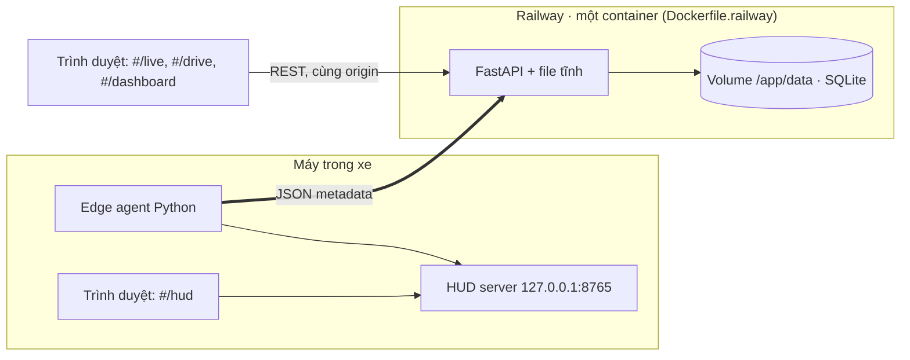

# Architecture Document

## System Overview

DriverGuard giám sát tài xế bằng camera trong xe và cảnh báo khi buồn ngủ hoặc mất tập trung. Mọi xử lý ảnh chạy
on-device: frame chỉ nằm trong RAM, backend chỉ nhận JSON metadata. Hệ thống dùng model pretrained cộng với luật theo
thời gian; không có LLM, LangGraph hay Vector Store (code LangGraph trong `src/` là mẫu của khoá học, DriverGuard không dùng).

## Architecture Diagram

PNG: [docs/diagrams/png/architecture.png](diagrams/png/architecture.png). Hình sinh từ
[docs/diagrams/build_architecture.py](diagrams/build_architecture.py). Các hình chi tiết (14 khối, hai cách chạy,
trình tự một cảnh báo, deployment) ở [architecture_diagram.md](architecture_diagram.md).

## Components

### 1. Frontend (React 19 + Vite + Tailwind v4)
- **Purpose:** một bundle, bốn trang theo hash route.
- **Trang:** `#/hud` (màn hình trong xe, đọc agent qua HTTP cục bộ), `#/live` (cả agent chạy trong trình duyệt),
  `#/drive` (giả lập tốc độ / xi nhan), `#/dashboard` (tài xế, quản lý, kỹ sư, admin).
- **Code:** `frontend/src/`.

### 2. Backend (FastAPI)
- **Purpose:** nhận và lưu metadata, phục vụ dashboard, giữ ngưỡng đã chỉnh, phục vụ file tĩnh. Không chạy model nào.
- **API Design:** REST. Nhóm route: `/auth/*`, `/api/v1/events` và `/web/events`, `/thresholds*`, `/trips`, `/trip-reports`,
  `/fleet`, `/timeline`, `/stats`, `/drive/{code}`, `/policy`, `/me/*`, `/deletion-requests`, `/access-log`.
- **Authentication:** JWT theo vai trò cho người dùng; `X-Device-Key` cho thiết bị.
- **Code:** `backend/`, `deploy/railway_app.py`.

### 3. Agent (edge agent, không phải LangGraph)
- **Agent Type:** pipeline cố định 14 khối, chạy mỗi frame. Không có LLM.
- **State:** các dataclass truyền giữa khối (đặc trưng mỗi frame, trạng thái buồn ngủ / mất tập trung, mức L0–L3).
- **Khối:** 1 Camera → 2 Tiền xử lý → 3 MediaPipe / 4 YOLOv8n → 6 Đặc trưng → 5 CNN mắt (chỉ khi EAR không tin được)
  → 7 Buồn ngủ + 8 Mất tập trung → 9 Risk engine (+ 10 Ngữ cảnh xe, 11 Trip memory) → 12 Alert manager
  → 13 HUD + 14 Metadata publisher.
- **Hai cách chạy:** trên thiết bị (`python -m edge_agent.main`) và trong trình duyệt (`#/live`: khối 6–12 là cùng
  code Python chạy bằng Pyodide).
- **Code:** `edge_agent/`; mọi ngưỡng ở `config/thresholds.yaml`.

### 4. Database
- **Type:** SQLite trên volume `/app/data`.
- **Tables:** `users`, `devices`, `device_status`, `events`, `fatigue_samples`, `trip_summaries`, `threshold_versions`,
  `threshold_rollout`, `threshold_pins`, `deletion_requests`, `access_log`.
- **Schema:** tạo và nâng cấp trong `backend/db.py` (không dùng Alembic).

### 5. Vector Store
Không có. Hệ thống không dùng RAG hay embedding.

### 6. External
- Ba nguồn model pretrained, chỉ dùng lúc cài đặt / build (`tools/download_models.py`): Google MediaPipe
  (`face_landmarker.task`), Intel Open Model Zoo (`open-closed-eye-0001`), Ultralytics (`yolov8n.pt` xuất sang ONNX).
- Lúc chạy không gọi API bên ngoài nào; Pyodide và wasm của MediaPipe cũng do backend phục vụ (M99).

## Data Flow

1. Camera đưa frame vào agent; khối 1–6 biến frame thành số (EAR, MAR, góc đầu, cờ điện thoại). Frame không ghi ra đĩa.
2. Khối 7–12 tính điểm theo thời gian, ra mức L0–L3 và lý do.
3. Khối 13 đưa trạng thái cho `#/hud` (trang hỏi `GET /state` mỗi 0,3 s; gửi lại phản hồi, đổi tài xế, kết thúc chuyến).
4. Khối 14 gom sự kiện vào outbox và gửi `POST /api/v1/events` (chỉ JSON, `X-Device-Key`). Trang `#/live` gửi
   `POST /api/v1/web/events` bằng token người dùng.
5. Backend kiểm payload (có ảnh / base64 thì trả 422), ghi SQLite.
6. Dashboard đọc qua REST + JWT; kỹ sư chỉnh ngưỡng, agent lấy về lúc khởi động và mỗi 5 phút, áp khi xe đang nghỉ.

## Deployment Architecture

Chi tiết và các địa chỉ đang chạy: [architecture_diagram.md mục 4](architecture_diagram.md#4-deployment),
[docs/deploy-railway.md](deploy-railway.md).

## Security

- Ảnh khuôn mặt không rời thiết bị: publisher chặn dữ liệu giống ảnh trước khi gửi, backend chặn lần nữa (HTTP 422).
- JWT theo vai trò cho người dùng, `X-Device-Key` cho thiết bị; secret nằm trong biến môi trường, không commit.
- Backend và frontend cùng origin, có Content-Security-Policy (M99).
- HUD server chỉ nghe ở `127.0.0.1` và kiểm nguồn gọi (M84).
- Chi tiết: [SECURITY.md](../SECURITY.md), [docs/data-policy.md](data-policy.md).

## Design Decisions

| Decision | Choice | Reason |
|----------|--------|--------|
| Nơi xử lý ảnh | On-device (thiết bị hoặc trình duyệt) | Ảnh khuôn mặt không được gửi hay lưu |
| Agent | Pipeline 14 khối + luật, không LLM | Phải đạt ≥ 15 FPS, quyết định giải thích được, test bằng chuỗi số giả |
| Model | Chỉ pretrained (MediaPipe, YOLOv8n, CNN mắt) | Không train model mới |
| Database | SQLite | Một container, một volume; dữ liệu là metadata dạng bảng |
| Frontend | React, một bundle cùng origin với API | Không cần CORS; `#/live` dùng lại code Python của thiết bị qua Pyodide |
