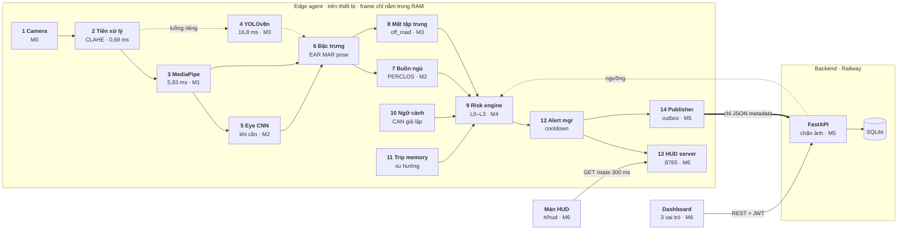
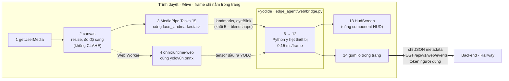
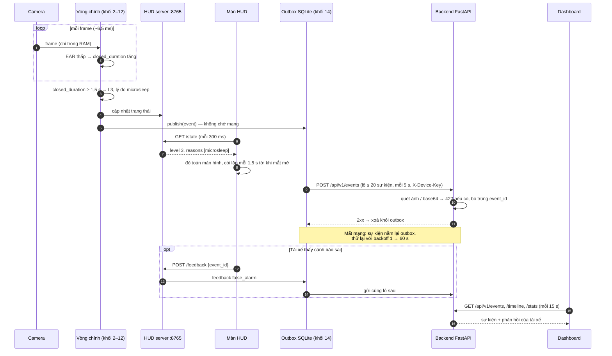
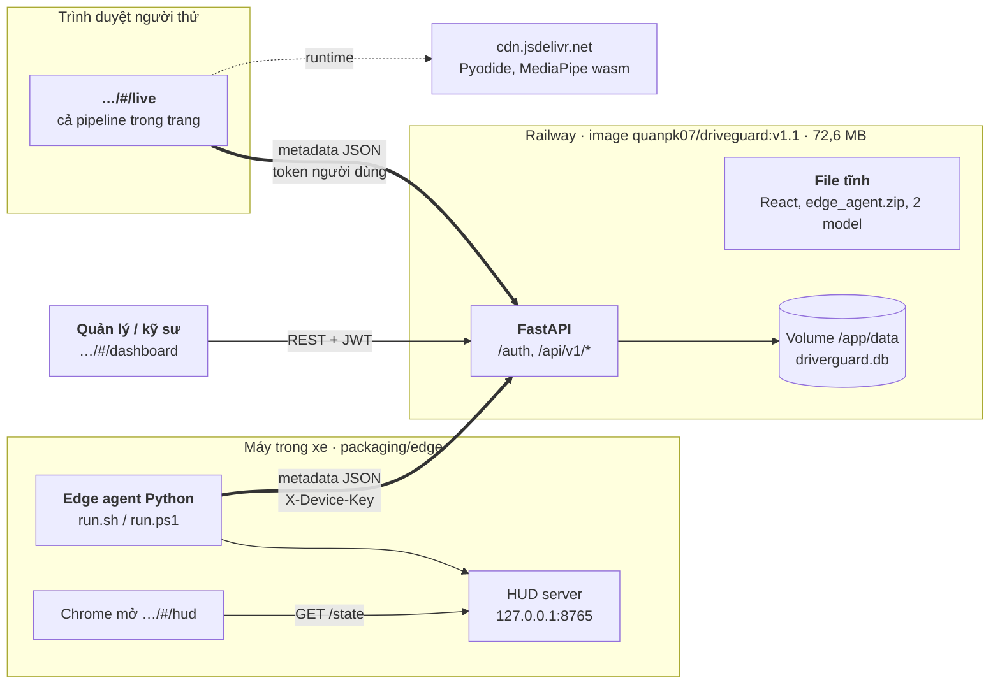
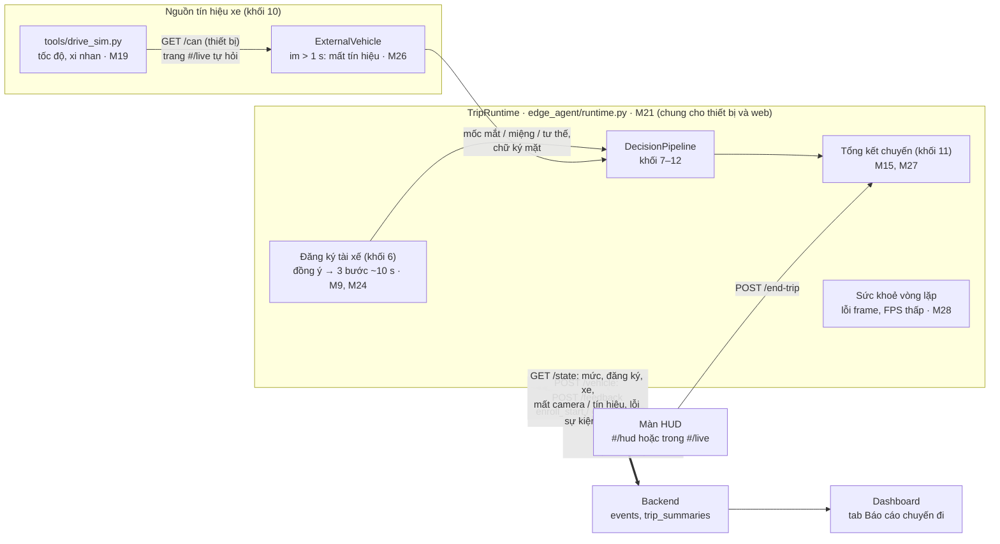

# Architecture Diagram — DriverGuard

Sơ đồ kiến trúc theo code trên nhánh DAQuan. Hình 1–4 vẽ từ 30/09/2026 (sau M8, bản v1.1) và vẫn đúng
về khung 14 khối; **phần thêm ở v2 (đến M28, 02/10/2026) ở [mục 5](#5-phần-thêm-ở-v2)**. Năm hình, mỗi
hình trả lời một câu hỏi:

1. [Thành phần và luồng dữ liệu](#1-thành-phần-và-luồng-dữ-liệu): 14 khối nối với nhau thế nào, dữ liệu rời thiết bị ở đâu.
2. [Hai cách chạy cùng một logic](#2-hai-cách-chạy-cùng-một-logic): thiết bị (Python) và trình duyệt (`#/live`).
3. [Một cảnh báo đi từ camera tới dashboard](#3-một-cảnh-báo-đi-từ-camera-tới-dashboard): thứ tự và thời gian.
4. [Deployment](#4-deployment): cái gì chạy ở máy nào.
5. [Phần thêm ở v2](#5-phần-thêm-ở-v2): đăng ký tài xế, tổng kết chuyến, nguồn tín hiệu xe, lớp chung
   `TripRuntime`, các đường HUD → agent, khi nào hệ thống báo "không giám sát".

Thời gian mỗi khối lấy từ [`eval/results/benchmark.md`](../eval/results/benchmark.md)
(Mac ARM, video YawDD 640×480). Mã `M0`…`M8` là mốc trong [`roadmap.md`](roadmap.md) đã làm ra khối đó.

---

## 1. Thành phần và luồng dữ liệu

Cách đọc:

- **Khung "Edge agent"** là ranh giới on-device. Frame camera chỉ đi qua khối 1–5 trong RAM, không ghi ra đĩa.
  Từ khối 6 trở đi chỉ còn số (EAR, MAR, góc đầu, cờ điện thoại).
- **Mũi tên đậm** (khối 14 → FastAPI) là đường duy nhất dữ liệu rời thiết bị. Chỉ có JSON metadata;
  publisher chặn dữ liệu nhị phân / base64 ngay trên thiết bị, backend chặn lần nữa (HTTP 422).
- **Nét đứt** là đường không đồng bộ: YOLO chạy luồng riêng khoảng 5 lần/giây nên vòng chính vẫn đạt
  151,8 FPS; ngưỡng chỉnh trên dashboard được thiết bị tải về một lần lúc khởi động
  ([`edge_agent/io/remote_config.py`](../edge_agent/io/remote_config.py)).
- **Khối 3 → 5 → 6**: MediaPipe trả 478 điểm và blendshape `eyeBlink`. Khối 5 cắt vùng mắt theo landmark,
  chỉ được gọi khi EAR không tin được (mặt tối, camera IR, hai mắt lệch EAR), và gửi `p_closed` cho khối 6.
  Nguồn chọn trong `config/thresholds.yaml` (`eye_state.source`). YOLO gửi cờ `phone_near_face`.
- **Vào khối 9**: nhánh 7 và 8 gửi điểm, khối 10 gửi tốc độ (đang chạy hay đứng yên), khối 11 gửi xu hướng mệt của cả chuyến.
- **Ra khỏi khối 12**: mức + lý do cho HUD server (màn `#/hud` hỏi mỗi 300 ms), và sự kiện cho publisher.
- **Backend** lưu vào SQLite: `events`, `fatigue_samples`, `threshold_versions`, `users`, `devices`.
  Dashboard gọi REST với JWT và tự làm mới mỗi 15 s.
- **Khối 7–12** cộng lại tốn 0,01 ms/frame; phần nặng nhất trên vòng chính là MediaPipe (5,83 ms).

---

## 2. Hai cách chạy cùng một logic

Khối 6–12 là **cùng một code Python** ở cả hai nơi. Trên trình duyệt (M8), Pyodide chạy
[`edge_agent/web/bridge.py`](../edge_agent/web/bridge.py), gọi đúng `DecisionPipeline` của thiết bị.
Chỉ khối 1–5, 13, 14 được viết lại cho trình duyệt.

| Khối | Thiết bị (`python -m edge_agent.main`) | Trình duyệt (`#/live`) |
|---|---|---|
| 1 Camera | OpenCV, webcam hoặc file video | `getUserMedia` |
| 2 Tiền xử lý | resize + CLAHE trên kênh Y | resize trên canvas, không CLAHE |
| 3 Landmark | MediaPipe Python | MediaPipe Tasks JS, cùng model |
| 4 Điện thoại | YOLOv8n ONNX, luồng riêng | onnxruntime-web trong Web Worker, cùng model |
| 5 Trạng thái mắt | CNN `open_closed_eye.onnx` | blendshape `eyeBlink` |
| 6–12 | Python | **cùng Python, chạy trong Pyodide** |
| 13 HUD | HUD server `127.0.0.1:8765` + trang `#/hud` | `HudScreen` ngay trong trang |
| 14 Gửi đi | outbox SQLite, `X-Device-Key` | trang gửi lô, token của người đăng nhập (thiết bị `web-<username>`) |

---

## 3. Một cảnh báo đi từ camera tới dashboard

Ví dụ: tài xế nhắm mắt liên tục. `risk.microsleep_l3_s` = 1,5 s nên lên L3 ngay khi đủ 1,5 s.

---

## 4. Deployment

- **Server không chạy model nào.** Image chỉ có FastAPI và file tĩnh (không OpenCV / MediaPipe / onnxruntime),
  nên nhỏ và rẻ. Mọi suy luận chạy trên máy trong xe hoặc trong trình duyệt người dùng.
- **Mũi tên đậm** là metadata JSON đi lên backend: edge agent xác thực bằng `X-Device-Key`,
  trang `#/live` bằng token của người đăng nhập.
- **File tĩnh** (không vẽ mũi tên cho gọn): mọi trình duyệt tải trang React từ cùng domain; `#/live` tải thêm
  `py/edge_agent.zip`, `face_landmarker.task`, `yolov8n.onnx` từ Railway và Pyodide 0.29.3 + MediaPipe wasm từ jsDelivr.
- **Image** build từ `Dockerfile.railway`, chạy `uvicorn deploy.railway_app:app`. Volume `/app/data` giữ SQLite qua các lần redeploy.
- **Backend và frontend cùng domain**, nên dashboard gọi API không cần cấu hình CORS.
  `--hud-origin` cho phép trang HUD trên Railway đọc HUD server ở `127.0.0.1` của chính máy đó.
- **`Dockerfile` ở gốc repo vẫn là app mẫu của khoá học** (`src.main:app`), không dùng cho DriverGuard.
- **v2 (01/10):** service riêng `driveguard-v2`, image `quanpk07/driveguard:v2`, volume riêng; v1 vẫn chạy
  song song. Chi tiết ở [`release-v2.md`](release-v2.md) mục 7.
- **Sản phẩm cuối (chốt 02/10):** app APK chạy trên hub gắn trên xe, bọc chính code web (Capacitor), mọi model
  và Pyodide đóng gói sẵn trong app; bản web trên Railway chỉ để xem thử. Chưa làm
  ([`improvements.md`](improvements.md)).

---

## 5. Phần thêm ở v2

- **`TripRuntime`** (M21) gom phần quanh khối 6–14 mà trước đó `main.py` (thiết bị) và `web/bridge.py` (trình
  duyệt) viết hai lần: lấy mẫu khối 10, `DecisionPipeline`, đăng ký, HUD, bản ghi khối 14, đổi tài xế, mất
  camera, mất tín hiệu xe, lỗi frame, kết thúc chuyến. Hai nơi chỉ còn phần vào / ra riêng.
- **Đăng ký tài xế** (khối 6, M9): xe dừng thì HUD hỏi đồng ý (M24, nói rõ không lưu / gửi ảnh), rồi 3 bước
  nhìn camera / nhìn đường / nhắm mắt. Kết quả chỉ nằm trong RAM một chuyến: mốc mắt mở / nhắm, miệng, tư thế
  "nhìn đường" cho khối 7, 8, và chữ ký mặt để khối 3 chọn đúng tài xế khi có hành khách.
- **Tổng kết chuyến** (khối 11, M15): cộng dồn từng frame, dựng khi tài xế bấm "Kết thúc chuyến"; gửi lên
  backend (bảng `trip_summaries`), quản lý / kỹ sư xem ở dashboard. Bỏ qua dấu hiệu buồn ngủ lúc nghỉ đỗ xe và
  lúc bước nhắm mắt của đăng ký (M27).
- **Nguồn tín hiệu xe:** công cụ mô phỏng `tools/drive_sim.py` thay CAN thật (M19); 0 km/h = đỗ. Đang chạy mà
  mất tín hiệu thì tốc độ "không biết", vẫn giám sát như đang chạy; mất lúc đỗ vẫn là đỗ; cả hai đều báo tài xế
  (M26). Xi nhan nới góc nhìn về đúng phía (M20).
- **Khi nào HUD báo "không giám sát"** (chi tiết: [`safety-fmea.md`](safety-fmea.md)): mất mặt ≥ 3 s khi chạy
  (M10), mất camera, lỗi xử lý ≥ 1 s hoặc không nhận dữ liệu / mất kết nối (M28, có âm báo to); FPS thấp kéo
  dài thì chip "Máy chậm" (M28). Âm thanh luôn bật, bật ở lần chạm đầu tiên (M23).
- **Khối 7 ở v2:** package `edge_agent/analysis/drowsiness/` (M21) thêm chớp chậm (M11), gục / cúi (M12),
  nhướn mày (M13), phân biệt cúi nhìn xuống với nhắm mắt (M25).

---

## Bảng thành phần

| Thành phần | Công nghệ | Code | Mốc |
|---|---|---|---|
| Khối 1 Camera | OpenCV; mất camera thì mở lại mỗi 2 s | `edge_agent/capture/frame_source.py` | M0 |
| Khối 2 Tiền xử lý | CLAHE trên kênh Y (YCrCb) | `edge_agent/perception/preprocess.py` | M0 |
| Khối 3 Landmark | MediaPipe Face Landmarker (float16, 3,76 MB) | `edge_agent/perception/landmarks.py` | M1 |
| Khối 4 Điện thoại | YOLOv8n ONNX (FP32 12,85 MB / INT8 3,61 MB) | `edge_agent/perception/phone_detector.py` | M3 |
| Khối 5 Trạng thái mắt | `open-closed-eye-0001` (Intel OMZ, 0,05 MB) | `edge_agent/perception/eye_state.py` | M2 |
| Khối 6 Đặc trưng | EAR, MAR, solvePnP | `edge_agent/perception/features.py` | M1 |
| Khối 7 Buồn ngủ | PERCLOS 60 s, microsleep, ngáp, gật | `edge_agent/analysis/drowsiness/` | M2 |
| Khối 8 Mất tập trung | off_road, phone_ratio_2s, no_face | `edge_agent/analysis/distraction.py` | M3 |
| Khối 9–12 Quyết định | risk engine, trip memory, alert manager | `edge_agent/decision/` | M4 |
| Khối 10 Ngữ cảnh | tốc độ CAN giả lập theo kịch bản | `edge_agent/context/` | M4 |
| Khối 13 HUD | HTTP server cục bộ + React | `edge_agent/hud/`, `frontend/src/hud/` | M6 |
| Khối 14 Publisher | outbox SQLite, lô, backoff | `edge_agent/io/publisher.py` | M5 |
| Backend | FastAPI, SQLite, JWT, khoá thiết bị | `backend/` | M5 |
| Dashboard | React 19, Tailwind v4 | `frontend/src/dashboard/` | M6 |
| Agent trên trình duyệt | Pyodide, MediaPipe Tasks JS, onnxruntime-web | `frontend/src/live/`, `edge_agent/web/bridge.py` | M8 |
| Ngưỡng | mọi ngưỡng ở một file, key lạ thì dừng agent | `config/thresholds.yaml` | — |
| Lớp chung một chuyến | `TripRuntime`: khối 6–14 cho thiết bị và web, mất tín hiệu xe, sức khoẻ vòng lặp | `edge_agent/runtime.py` | M21, M26, M28 |
| Đăng ký tài xế | màn hình đồng ý + 3 bước, mốc riêng từng tài xế (RAM, một chuyến) | `edge_agent/perception/enrollment.py` | M9, M24 |
| Tổng kết chuyến | cộng dồn từng frame, đánh giá chuyến, gợi ý nghỉ | `edge_agent/decision/trip_summary.py` | M15, M27 |
| Mô phỏng lái xe | tốc độ, xi nhan từ terminal, thay CAN thật | `tools/drive_sim.py`, `edge_agent/context/can_sim.py` | M19, M26 |
| Báo cáo chuyến đi | bảng `trip_summaries`, `/api/v1/trip-reports`, tab dashboard | `backend/`, `frontend/src/dashboard/` | M15 |

Tất cả model là pretrained, không train mới.
