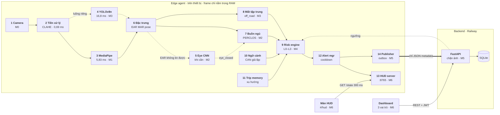
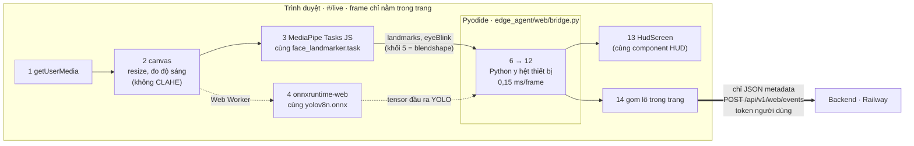
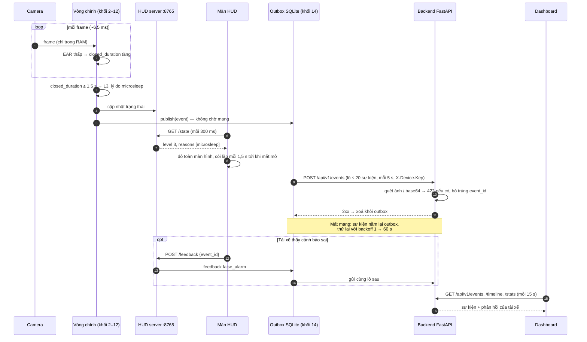
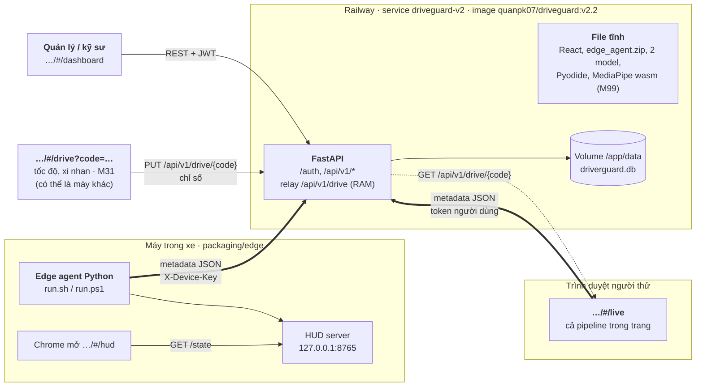
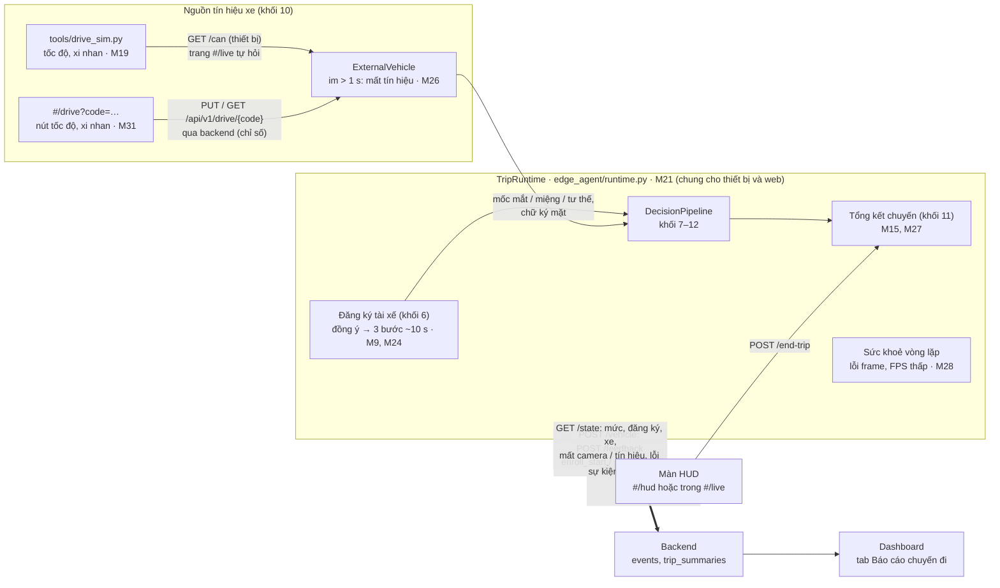

# Architecture Diagram — DriverGuard

Sơ đồ kiến trúc theo code trên nhánh DAQuan. Hình 1–4 vẽ từ 30/09/2026 (sau M8, bản v1.1) và vẫn đúng
về khung 14 khối; **phần thêm ở v2 (đến M31, 02/10/2026) ở [mục 5](#5-phần-thêm-ở-v2)**. Năm hình, mỗi
hình trả lời một câu hỏi; trước đó là **hình tổng quan một trang** (09/10/2026, theo code đến M101):

0. [Tổng quan hệ thống](#0-tổng-quan-hệ-thống): Frontend, Agent, Backend API, Database, External và các luồng dữ liệu.
1. [Thành phần và luồng dữ liệu](#1-thành-phần-và-luồng-dữ-liệu): 14 khối nối với nhau thế nào, dữ liệu rời thiết bị ở đâu.
2. [Hai cách chạy cùng một logic](#2-hai-cách-chạy-cùng-một-logic): thiết bị (Python) và trình duyệt (`#/live`).
3. [Một cảnh báo đi từ camera tới dashboard](#3-một-cảnh-báo-đi-từ-camera-tới-dashboard): thứ tự và thời gian.
4. [Deployment](#4-deployment): cái gì chạy ở máy nào.
5. [Phần thêm ở v2](#5-phần-thêm-ở-v2): đăng ký tài xế, tổng kết chuyến, nguồn tín hiệu xe, lớp chung
   `TripRuntime`, các đường HUD → agent, khi nào hệ thống báo "không giám sát".

Thời gian mỗi khối lấy từ [`eval/results/benchmark.md`](../eval/results/benchmark.md)
(Mac ARM, video YawDD 640×480). Mã `M0`…`M31` là mốc trong [`roadmap.md`](roadmap.md) đã làm ra khối đó.

---

## 0. Tổng quan hệ thống

PNG: [`diagrams/png/architecture.png`](diagrams/png/architecture.png). Hình sinh từ
[`diagrams/build_architecture.py`](diagrams/build_architecture.py); sửa bảng trong script rồi chạy lại, không sửa tay file SVG.

| Thành phần | Trong DriverGuard | Code |
|---|---|---|
| Frontend | React 19 + Vite + Tailwind v4, một bundle, bốn trang: `#/hud`, `#/live`, `#/drive`, `#/dashboard` | `frontend/src/` |
| Agent | Edge agent Python 14 khối, chạy trên thiết bị (hoặc trong trình duyệt bằng Pyodide ở `#/live`). Model pretrained + luật; **không có LLM, không dùng LangGraph** | `edge_agent/` |
| Backend API | FastAPI: đăng nhập (JWT), nhận sự kiện, ngưỡng, chuyến và báo cáo, relay tín hiệu xe, quyền dữ liệu, file tĩnh | `backend/`, `deploy/railway_app.py` |
| Database | SQLite trên volume `/app/data`, 11 bảng quan hệ. **Không có Vector Store** (không RAG, không embedding) | `backend/db.py` |
| External | Ba nguồn model pretrained (Google MediaPipe, Intel Open Model Zoo, Ultralytics), chỉ dùng lúc cài đặt / build. Lúc chạy không gọi API bên ngoài nào (từ M99 cả Pyodide và wasm cũng do backend phục vụ) | `tools/download_models.py` |

Luồng dữ liệu trên hình:

- **`#/hud` ↔ khối 13:** màn hình hỏi `GET /state` mỗi 0,3 s (`hud.poll_s`), gửi lại `POST /feedback`, `/vehicle`, `/end-trip`.
  Chỉ trong máy (`127.0.0.1:8765`).
- **Khối 14 → Backend (mũi tên đậm):** `POST /api/v1/events`, lô ≤ 20 sự kiện, ít nhất mỗi 5 s, xác thực bằng `X-Device-Key`.
  Đây là đường duy nhất dữ liệu rời thiết bị, và chỉ là JSON metadata.
- **`#/live` ↔ Backend (mũi tên đậm):** trang gửi `POST /api/v1/web/events` bằng token người đăng nhập; lấy ngưỡng
  (`/api/v1/web/thresholds`) và tốc độ / xi nhan theo mã ghép (`GET /api/v1/drive/{code}`).
- **`#/drive` → Backend:** `PUT /api/v1/drive/{code}`, chỉ có số; backend giữ trong RAM, không ghi database.
- **`#/dashboard` ↔ Backend:** REST + JWT, đọc sự kiện / báo cáo và chỉnh ngưỡng.
- **Backend → khối 9 (nét đứt):** agent lấy ngưỡng đã chỉnh ở `GET /api/v1/device/thresholds` lúc khởi động và hỏi lại
  mỗi 5 phút (`publisher.config_poll_s`); bản mới chỉ được áp khi xe đang nghỉ (M47, M79).
- **External → khối 1–6 (nét đứt):** `tools/download_models.py` tải / xuất ba model một lần lúc cài đặt.

---

## 1. Thành phần và luồng dữ liệu

Cách đọc:

- **Khung "Edge agent"** là ranh giới on-device. Frame camera chỉ đi qua khối 1–5 trong RAM, không ghi ra đĩa.
  Từ khối 6 trở đi chỉ còn số (EAR, MAR, góc đầu, cờ điện thoại).
- **Mũi tên đậm** (khối 14 → FastAPI) là đường duy nhất dữ liệu rời thiết bị. Chỉ có JSON metadata;
  publisher chặn dữ liệu nhị phân / base64 ngay trên thiết bị, backend chặn lần nữa (HTTP 422).
- **Nét đứt** là đường không đồng bộ: YOLO chạy luồng riêng khoảng 5 lần/giây nên vòng chính vẫn đạt
  151,8 FPS; ngưỡng chỉnh trên dashboard được thiết bị tải về lúc khởi động và hỏi lại mỗi 5 phút, bản mới chỉ
  áp khi xe đang nghỉ ([`edge_agent/io/remote_config.py`](../edge_agent/io/remote_config.py), M47, M79).
- **Khối 3 → 6 → 5**: MediaPipe trả 478 điểm và blendshape `eyeBlink`. Khối 5 chạy **sau** khối 6
  ([`edge_agent/main.py`](../edge_agent/main.py)): cắt vùng mắt theo landmark, chỉ được gọi khi EAR không tin được
  (mặt tối, camera IR, hai mắt lệch EAR), và ghi kết quả vào đặc trưng trước khi sang khối 7.
  Nguồn chọn trong `config/thresholds.yaml` (`eye_state.source`). YOLO gửi cờ `phone_near_face`.
- **Vào khối 9**: nhánh 7 và 8 gửi điểm, khối 10 gửi tốc độ (đang chạy hay đứng yên), khối 11 gửi xu hướng mệt của cả chuyến.
- **Ra khỏi khối 12**: mức + lý do cho HUD server (màn `#/hud` hỏi mỗi 300 ms), và sự kiện cho publisher.
- **Backend** lưu vào SQLite: `events`, `fatigue_samples`, `threshold_versions`, `users`, `devices`.
  Dashboard gọi REST với JWT và tự làm mới mỗi 15 s.
- **Khối 7–12** cộng lại tốn 0,01 ms/frame; phần nặng nhất trên vòng chính là MediaPipe (5,83 ms).

---

## 2. Hai cách chạy cùng một logic

Khối 6–12 là **cùng một code Python** ở cả hai nơi. Trên trình duyệt (M8), Pyodide chạy
[`edge_agent/web/bridge.py`](../edge_agent/web/bridge.py), gọi đúng `DecisionPipeline` của thiết bị.
Chỉ khối 1–5, 13, 14 được viết lại cho trình duyệt.

| Khối | Thiết bị (`python -m edge_agent.main`) | Trình duyệt (`#/live`) |
|---|---|---|
| 1 Camera | OpenCV, webcam hoặc file video | `getUserMedia` |
| 2 Tiền xử lý | resize + CLAHE trên kênh Y | resize trên canvas, không CLAHE |
| 3 Landmark | MediaPipe Python | MediaPipe Tasks JS, cùng model |
| 4 Điện thoại | YOLOv8n ONNX, luồng riêng | onnxruntime-web trong Web Worker, cùng model; chạy trên WebGPU khi trình duyệt có GPU thật, không thì wasm (M67) |
| 5 Trạng thái mắt | CNN `open_closed_eye.onnx` | blendshape `eyeBlink` |
| 6–12 | Python | **cùng Python, chạy trong Pyodide** |
| 10 Tín hiệu xe | `tools/drive_sim.py` qua `GET /can` (M19) | trang `#/drive?code=…` qua backend (M31); không có thì hỏi `drive_sim.py` trên `127.0.0.1` |
| 13 HUD | HUD server `127.0.0.1:8765` + trang `#/hud` | `HudScreen` ngay trong trang |
| 14 Gửi đi | outbox SQLite, `X-Device-Key` | trang gửi lô, token của người đăng nhập (thiết bị `web-<username>`) |

---

## 3. Một cảnh báo đi từ camera tới dashboard

Ví dụ: tài xế nhắm mắt liên tục. `risk.microsleep_l3_s` = 1,5 s nên lên L3 ngay khi đủ 1,5 s.

---

## 4. Deployment

- **Server không chạy model nào.** Image chỉ có FastAPI và file tĩnh (không OpenCV / MediaPipe / onnxruntime),
  nên nhỏ và rẻ. Mọi suy luận chạy trên máy trong xe hoặc trong trình duyệt người dùng.
- **Mũi tên đậm** là metadata JSON đi lên backend: edge agent xác thực bằng `X-Device-Key`,
  trang `#/live` bằng token của người đăng nhập.
- **File tĩnh** (không vẽ mũi tên cho gọn): mọi trình duyệt tải trang React từ cùng domain; `#/live` tải thêm
  `py/edge_agent.zip`, `face_landmarker.task`, `yolov8n.onnx` và, từ M99, cả Pyodide 0.29.3 lẫn wasm của MediaPipe từ Railway (trước đó từ jsDelivr). Mọi file đi kèm Content-Security-Policy.
- **Image** build từ `Dockerfile.railway`, chạy `uvicorn deploy.railway_app:app`. Volume `/app/data` giữ SQLite qua các lần redeploy.
- **Backend và frontend cùng domain**, nên dashboard gọi API không cần cấu hình CORS.
  `--hud-origin` cho phép trang HUD trên Railway đọc HUD server ở `127.0.0.1` của chính máy đó.
- **`Dockerfile` ở gốc repo vẫn là app mẫu của khoá học** (`src.main:app`), không dùng cho DriverGuard.
- **Hai service chạy song song:** hình vẽ service `driveguard-v2` (từ 01/10, volume và JWT secret riêng), đang
  chạy image `quanpk07/driveguard:v2.2` (02/10, đến M31). Service `driveguard` của v1 vẫn chạy image `v1.1`
  (72,6 MB), không có `#/drive`. Chi tiết ở [`release-v2.md`](release-v2.md) mục 7.
- **`#/drive`** (M31) gửi tốc độ / xi nhan lên backend theo mã ghép; `#/live` hỏi lại backend bằng mã đó.
  Backend chỉ giữ số mới nhất trong bộ nhớ (hết hạn sau 10 phút, không ghi database).
- **Sản phẩm cuối (chốt 02/10, đổi 08/10):** thiết kế là app APK chạy trên hub gắn trên xe, bọc chính code web
  (Capacitor), mọi model và Pyodide đóng gói sẵn trong app. Không có code APK nào; đóng gói APK đã bỏ ngày 08/10 (không còn hub và xe thật, [danh sách](improvements.md#bo-hub)).
  Đầu ra hiện tại là bản web mô phỏng trên Railway; từ M99 nó không còn tải code từ CDN (bản đang deploy thì chưa có M99).

---

## 5. Phần thêm ở v2

- **`TripRuntime`** (M21) gom phần quanh khối 6–14 mà trước đó `main.py` (thiết bị) và `web/bridge.py` (trình
  duyệt) viết hai lần: lấy mẫu khối 10, `DecisionPipeline`, đăng ký, HUD, bản ghi khối 14, đổi tài xế, mất
  camera, mất tín hiệu xe, lỗi frame, kết thúc chuyến. Hai nơi chỉ còn phần vào / ra riêng.
- **Đăng ký tài xế** (khối 6, M9): xe dừng thì HUD hỏi đồng ý (M24, nói rõ không lưu / gửi ảnh), rồi 3 bước
  nhìn camera / nhìn đường / nhắm mắt. Kết quả chỉ nằm trong RAM một chuyến: mốc mắt mở / nhắm, miệng, tư thế
  "nhìn đường" cho khối 7, 8, và chữ ký mặt để khối 3 chọn đúng tài xế khi có hành khách.
- **Tổng kết chuyến** (khối 11, M15): cộng dồn từng frame, dựng khi tài xế bấm "Kết thúc chuyến"; gửi lên
  backend (bảng `trip_summaries`), quản lý / kỹ sư xem ở dashboard. Bỏ qua dấu hiệu buồn ngủ lúc nghỉ đỗ xe và
  lúc bước nhắm mắt của đăng ký (M27).
- **Nguồn tín hiệu xe:** công cụ mô phỏng `tools/drive_sim.py` thay CAN thật (M19), hoặc trang `#/drive` trên
  web (M31, có thể mở trên máy khác: backend giữ tốc độ / xi nhan mới nhất theo mã ghép, trong bộ nhớ, tự hết
  hạn); 0 km/h = đỗ và không cảnh báo nào (M30). Đang chạy mà
  mất tín hiệu thì tốc độ "không biết", vẫn giám sát như đang chạy; mất lúc đỗ vẫn là đỗ; cả hai đều báo tài xế
  (M26). Xi nhan nới góc nhìn về đúng phía (M20).
- **Khi nào HUD báo "không giám sát"** (chi tiết: [`safety-fmea.md`](safety-fmea.md)): mất mặt ≥ 3 s khi chạy
  (M10), mất camera, lỗi xử lý ≥ 1 s hoặc không nhận dữ liệu / mất kết nối (M28, có âm báo to); FPS thấp kéo
  dài thì chip "Máy chậm" (M28). Âm thanh luôn bật, bật ở lần chạm đầu tiên (M23).
- **Khối 7 ở v2:** package `edge_agent/analysis/drowsiness/` (M21) thêm chớp chậm (M11), gục / cúi (M12),
  nhướn mày (M13), phân biệt cúi nhìn xuống với nhắm mắt (M25).

---

## Bảng thành phần

| Thành phần | Công nghệ | Code | Mốc |
|---|---|---|---|
| Khối 1 Camera | OpenCV; mất camera thì mở lại mỗi 2 s | `edge_agent/capture/frame_source.py` | M0 |
| Khối 2 Tiền xử lý | CLAHE trên kênh Y (YCrCb) | `edge_agent/perception/preprocess.py` | M0 |
| Khối 3 Landmark | MediaPipe Face Landmarker (float16, 3,76 MB) | `edge_agent/perception/landmarks.py` | M1 |
| Khối 4 Điện thoại | YOLOv8n ONNX FP32 12,85 MB (file INT8 3,61 MB hiện có không phát hiện được điện thoại nào, không dùng; M54) | `edge_agent/perception/phone_detector.py` | M3 |
| Khối 5 Trạng thái mắt | `open-closed-eye-0001` (Intel OMZ, 0,05 MB) | `edge_agent/perception/eye_state.py` | M2 |
| Khối 6 Đặc trưng | EAR, MAR, solvePnP | `edge_agent/perception/features.py` | M1 |
| Khối 7 Buồn ngủ | PERCLOS 60 s, microsleep, ngáp, gật | `edge_agent/analysis/drowsiness/` | M2 |
| Khối 8 Mất tập trung | off_road, phone_ratio_2s, no_face | `edge_agent/analysis/distraction.py` | M3 |
| Khối 9–12 Quyết định | risk engine, trip memory, alert manager; 0 km/h thì không cảnh báo | `edge_agent/decision/` | M4, M30 |
| Khối 10 Ngữ cảnh | tốc độ CAN giả lập theo kịch bản | `edge_agent/context/` | M4 |
| Khối 13 HUD | HTTP server cục bộ + React | `edge_agent/hud/`, `frontend/src/hud/` | M6 |
| Khối 14 Publisher | outbox SQLite, lô, backoff | `edge_agent/io/publisher.py` | M5 |
| Backend | FastAPI, SQLite, JWT, khoá thiết bị | `backend/` | M5 |
| Dashboard | React 19, Tailwind v4 | `frontend/src/dashboard/` | M6 |
| Agent trên trình duyệt | Pyodide, MediaPipe Tasks JS, onnxruntime-web | `frontend/src/live/`, `edge_agent/web/bridge.py` | M8 |
| Ngưỡng | mọi ngưỡng ở một file, key lạ thì dừng agent | `config/thresholds.yaml` | — |
| Lớp chung một chuyến | `TripRuntime`: khối 6–14 cho thiết bị và web, mất tín hiệu xe, sức khoẻ vòng lặp | `edge_agent/runtime.py` | M21, M26, M28 |
| Đăng ký tài xế | màn hình đồng ý + 3 bước, mốc riêng từng tài xế (RAM, một chuyến) | `edge_agent/perception/enrollment.py` | M9, M24 |
| Tổng kết chuyến | cộng dồn từng frame, đánh giá chuyến, gợi ý nghỉ | `edge_agent/decision/trip_summary.py` | M15, M27 |
| Mô phỏng lái xe | tốc độ, xi nhan từ terminal, thay CAN thật | `tools/drive_sim.py`, `edge_agent/context/can_sim.py` | M19, M26 |
| Điều khiển xe trên web | trang `#/drive`, backend relay theo mã ghép (trong bộ nhớ) | `frontend/src/drive/`, `backend/drive_link.py` | M31 |
| Báo cáo chuyến đi | bảng `trip_summaries`, `/api/v1/trip-reports`, tab dashboard | `backend/`, `frontend/src/dashboard/` | M15 |

Tất cả model là pretrained, không train mới.
