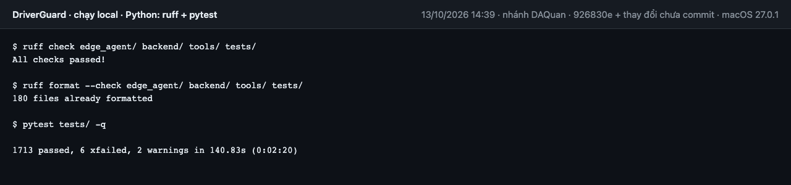
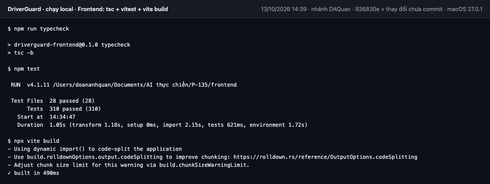
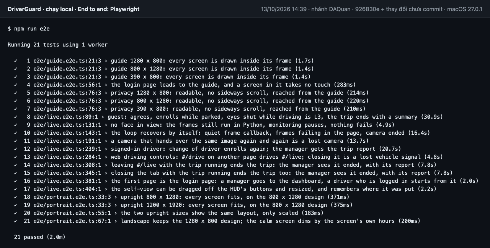

# Kết quả kiểm tra chạy local (13/10/2026)

CI trên GitHub không chạy được từ 12/10: mọi job dừng sau 2–5 giây, trước khi tới bước nào, với thông báo của GitHub
"The job was not started because recent account payments have failed or your spending limit needs to be increased"
(ví dụ lần chạy 38340278542 trên `main`). Đây là tài khoản của tổ chức `AI20K-Build-Phase-Cohort-4`, không phải lỗi của
code. Trang này ghi lại cùng các bước của [.github/workflows/ci.yml](../.github/workflows/ci.yml), chạy trên máy dev.

- **Khi nào, ở đâu:** 13/10/2026, macOS, Python 3.12 (`.venv`), Node 22; nhánh `DAQuan` ở commit `926830e` cộng các thay
  đổi chưa commit của ngày 13/10 (trang `#/privacy`, M106). Nhánh này chưa gộp 8 commit mới của `main` (M103–M105).
- **Không chạy lại ở đây:** job `models` (model thật + đo FPS) và job `template` (code mẫu của khoá học).
- Ảnh dưới đây dựng từ log của chính lần chạy đó (đã bỏ các dòng cảnh báo của công cụ), không phải ảnh chụp cửa sổ terminal.

| Job của CI | Lệnh | Kết quả |
|---|---|---|
| `python` | `ruff check`, `ruff format --check`, `pytest tests/` | ruff sạch, 180 file đúng định dạng; **1713 pass, 6 xfail** |
| `frontend` | `npm run typecheck`, `npm test`, `npx vite build` | `tsc` sạch; **310 pass** (28 file); build xong |
| `e2e` | `npm run e2e` (Playwright, Chromium) | **21 / 21 pass** |

## Python

## Frontend

## End to end

