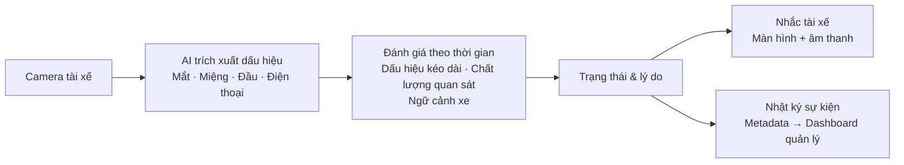

# DriverGuard — Nội dung pitch

## 0. Mở đầu

Chúng tôi là team DriverGuard, bốn thành viên của AI20K Build Phase Cohort 4, VinUni. DriverGuard là hệ thống giám sát tài xế chạy ngay trên thiết bị: nhắc tài xế khi có dấu hiệu buồn ngủ hoặc mất tập trung, và nói rõ khi không quan sát được.

## 1. Problem — Khi tài xế mất tỉnh táo, ai nhắc họ đúng lúc?

Mỗi năm thế giới có khoảng 1,19 triệu người chết vì tai nạn giao thông (WHO, 2023). Ở Việt Nam, 11 tháng đầu năm 2025 có 16 938 vụ và 9 549 người chết. Buồn ngủ khi lái khó đếm vì không để lại bằng chứng xét nghiệm được: ở Mỹ năm 2023, số chính thức là 633 người chết, còn ước tính của GHSA là hơn 6 300.

> Nguồn, đã mở kiểm ngày 10/10/2026: [WHO, Global status report on road safety 2023](https://www.who.int/publications/i/item/9789240086517); [lsvn.vn, số của Ủy ban ATGT Quốc gia](https://lsvn.vn/11-thang-nam-2025-tngt-duong-bo-giam-hon-23-a166350.html) (15/12/2024–14/11/2025, mọi loại hình giao thông); [GHSA, Wake Up Call 2026 Update](https://www.ghsa.org/sites/default/files/2026-02/Wake_Up_Call_2026_Update.pdf) (633 là số NHTSA, hơn 6 300 là ước tính theo mô hình của GHSA; số này đọc qua bản tóm tắt, chưa mở được PDF gốc). Chưa có số tai nạn do buồn ngủ hoặc mất tập trung riêng cho Việt Nam.

Khi tài xế nhắm mắt lâu, gục đầu hoặc nhìn điện thoại, họ cần một lời nhắc ngay tại xe. Người quản lý đội xe cũng cần biết sự kiện đã xảy ra để xem xét chuyến và hỗ trợ tài xế.

Bài toán là biến dấu hiệu thành cảnh báo có ích: hạn chế báo sai, tránh bỏ sót và nói rõ khi camera không quan sát được.

**DriverGuard nối ba việc: phát hiện dấu hiệu, nhắc tài xế và theo dõi sự kiện.**

## 2. Solution — Từ camera đến lời nhắc và nhật ký chuyến

DriverGuard dùng camera hướng vào tài xế để quan sát mắt, miệng, tư thế đầu và dấu hiệu sử dụng điện thoại.

Hệ thống theo dõi các tín hiệu theo thời gian và xếp thành bốn mức. L0 là bình thường. L1 là nhắc nhẹ trên màn hình. L2 là màu cam kèm âm báo, ví dụ khi cầm điện thoại hoặc nhìn khỏi đường lâu. L3 là đỏ toàn màn hình kèm còi, khi nhắm mắt từ 1,5 giây lúc xe đang chạy.

Tài xế chỉ cần phân biệt ba trạng thái trên màn hình: bình thường, cảnh báo và không quan sát được. Khi không đọc được tài xế, màn hình báo tạm ngưng giám sát.

Người quản lý xem sự kiện và báo cáo chuyến trên dashboard. Ảnh được xử lý cục bộ; máy chủ nhận số liệu sự kiện — như thời điểm, mức cảnh báo và lý do — để phục vụ nhật ký.

Ba điểm DriverGuard theo đuổi: cảnh báo có lý do, công khai khi không giám sát được, và nhật ký chỉ gồm số liệu.

Hiện sản phẩm có bản web mô phỏng và agent Python; tín hiệu tốc độ trong demo là giả lập.

**[Chiếu video demo tại đây: [docs/video-demo.md](video-demo.md)]**

## 3. Core Technology — AI quan sát, logic theo thời gian quyết định

DriverGuard hoạt động qua ba lớp: **Nhận biết → Đánh giá → Hành động**.

- **Không quan sát được → báo tạm ngưng giám sát, không đoán trạng thái tài xế.**
- **Ảnh được xử lý cục bộ; chỉ metadata sự kiện gửi lên máy chủ.**

Model thị giác có sẵn nhận biết dấu hiệu; logic nhóm xây đánh giá theo thời gian để đưa ra lời nhắc và nhật ký có lý do. Lõi quyết định được dùng chung giữa Python và web; đóng góp của nhóm nằm ở cách tích hợp tín hiệu, thay vì huấn luyện model mới.

Vòng xử lý Python đạt 29,9 khung hình mỗi giây trên máy phát triển, so với yêu cầu tối thiểu 15. Con số này chưa đo trên thiết bị đích.

## 4. Results & Differentiation — Đã có sản phẩm và kết quả offline

DriverGuard đã nối camera, cảnh báo trực tiếp và báo cáo chuyến trên dashboard.

**Về phát hiện buồn ngủ:** trên 44 video lái xe ban đêm với hành động diễn (bộ FL3D), **77/95 lần nhắm mắt kéo dài ít nhất 1,5 giây đạt mức L3**. Trên bản tự ghi của một người, 38/59 lần nhắm mắt được cảnh báo; ở những lần đó cảnh báo tới sau khoảng 1,9 giây, so với mục tiêu 3 giây.

**Về báo sai:** trên video của 24 người ngồi trước laptop và tự đánh giá là tỉnh táo (bộ UTA-RLDD, nửa giữ riêng để kiểm tra), hệ thống phát **5 cảnh báo sai trong 4,28 giờ, khoảng 1,2 lần mỗi giờ**. Mục tiêu là không quá 1 lần mỗi giờ, nên kết quả này chưa chứng minh đạt mục tiêu.

**Về mất tập trung:** kết quả còn yếu hơn nhánh buồn ngủ. Trên bản tự ghi, gọi điện được báo 9/9 lần và quay đầu 8/8, nhưng nhắn tin chỉ 6/11 và cúi nhìn điện thoại 0/13. Đây là phần cần cải thiện tiếp.

Nhóm cũng kiểm tra ngưỡng cảnh báo trên một bộ dữ liệu thứ ba (DROZY) theo luật viết trước khi chạy, và giữ nguyên ngưỡng vì điều kiện đổi không thỏa.

**Khác biệt:** cảnh báo có lý do, công khai khi không giám sát được, và nhật ký chỉ gồm số liệu. Tất cả kết quả trên là đánh giá offline; chưa có đối chứng với giải pháp thương mại về độ chính xác hoặc chi phí.

## 5. Khó khăn và bài học

**Khó khăn lớn nhất là báo sai.** Trên nửa kiểm tra của UTA-RLDD, nhánh buồn ngủ ban đầu báo sai 8 lần trong 4,08 giờ. Sau khi tắt ba thành phần không chứng minh được giá trị (chớp chậm, nhướn mày và mức cảnh báo theo xu hướng), còn 4 lần.

**Bản web từng bỏ sót gần hết lần nhắm mắt** với camera xám hoặc hồng ngoại, vì dùng nhầm ngưỡng của model mắt cho một tín hiệu khác. Sau khi sửa, số lần phát hiện trên bản tự ghi tăng từ 0/48 lên 46/48.

**Bài học:** viết luật quyết định trước khi xem số, để không chọn ngưỡng theo kết quả mong muốn. Tập kiểm tra đọc nhiều lần thì không còn độc lập hoàn toàn.

**Nếu làm lại:** khóa tập kiểm tra và chọn thiết bị đích ngay từ đầu.

## 6. Lộ trình phát triển — Từ prototype đến triển khai thực tế

**Hiện tại:** bản web mô phỏng với tốc độ giả lập và kết quả đánh giá offline. Chưa kiểm chứng trên thiết bị đích hoặc đường thật.

**Bước tiếp theo:**

- Đo lại báo sai, khả năng phát hiện và độ trễ trên dữ liệu mới.
- Cải thiện các tình huống dễ nhận sai, trước hết là cúi nhìn điện thoại.
- Kiểm tra 10 người xem có gọi đúng ba trạng thái trên màn hình không.
- Giữ được sự kiện trên bản web khi mất mạng.

**Xa hơn**, khi có đối tác và thiết bị: tích hợp tốc độ thật, kiểm thử suốt chuyến, rồi thử nghiệm quy mô nhỏ cùng đội xe. Nhóm không cố tình tạo buồn ngủ hoặc mất tập trung khi lái trên đường.

**Chúng tôi tìm một đối tác đội xe để cùng xác định bài toán thực tế, và một cố vấn hỗ trợ thiết kế bước kiểm chứng tiếp theo.**

## 7. Team và kết

| Thành viên | Vai trò |
|---|---|
| Đoàn Anh Quân | Edge agent và chống báo sai, đánh giá trên dataset, bản web, backend, deploy |
| Hoàng Đức Dũng | Pipeline 14 khối, backend và dashboard ban đầu, giao diện Version 4, giọng nói tiếng Việt |
| Nguyễn Phúc Huy | PRD, sơ đồ Use Case và User Flow |
| Ngô Hoàng Thụy Khuê | PRD gate 1 |

DriverGuard hướng tới lời nhắc có ích, giới hạn được nói rõ và sự kiện có thể xem lại. Cảm ơn ban giám khảo, chúng tôi sẵn sàng nhận câu hỏi.

---

# Appendix — Dùng khi cần giải thích hoặc trả lời phản biện

## A1. Sản phẩm hiện có và phạm vi

**Các cập nhật sản phẩm gần nhất:** M97 xử lý refresh token và upload có giới hạn; M99 phục vụ runtime từ bản build; M100 cho di chuyển/đổi cỡ khung camera, gửi kết thúc chuyến khi rời trang và sửa hành vi âm thanh. Đây là cập nhật trong code; gửi khi đóng tab vẫn là best-effort, không hứa giữ đủ mọi sự kiện.

**Nguồn:** [M97, roadmap.md:2543](roadmap.md#L2543), [M99:2608](roadmap.md#L2608), [M100:2641](roadmap.md#L2641).

| Đã có trong code | Chưa có bằng chứng / ngoài kế hoạch hiện tại |
|---|---|
| Python agent, web live, HUD | Chạy ổn định trên điện thoại hoặc hub cả chuyến |
| API, dashboard, nhật ký và báo cáo chuyến | Pilot đường thật, tác động giảm tai nạn |
| Luật thời gian, chất lượng, cảnh báo và reset | Độ tin cậy trên mọi ánh sáng, kính và góc camera |
| Tốc độ và xi nhan mô phỏng | CAN thật, APK/hub trong scope hiện tại |
| Metadata guard, phân quyền, retention | Audit bảo mật và triển khai độc lập |

**Nguồn:** [pilot-readiness.md:68](pilot-readiness.md#L68), [dòng 75–87](pilot-readiness.md#L75); [frontend/src/App.tsx:8](../frontend/src/App.tsx#L8); [backend/app.py:369](../backend/app.py#L369).

## A2. Công nghệ và ranh giới local/cloud

**Luồng:** camera → nhận diện → đặc trưng số → quyết định theo thời gian → HUD → metadata → backend/dashboard.

- MediaPipe cung cấp điểm mặt và tín hiệu mắt; YOLOv8n nhận diện điện thoại.
- Python có eye CNN fallback; web dùng eyeBlink. Hai đường dùng chung logic nhưng đầu vào nhận diện khác nhau.
- Điểm buồn ngủ 0–100 là tổng hợp theo luật, không phải xác suất. Slow blink và brow hiện có trọng số 0.
- Ảnh và suy luận chạy local. Đăng nhập, cấu hình, upload và dashboard vẫn cần backend.
- Python giữ outbox SQLite; web giữ hàng đợi RAM. Chưa chứng minh offline hoàn toàn hoặc không mất sự kiện khi đóng trang.

**Nguồn:** [edge_agent/web/bridge.py:3](../edge_agent/web/bridge.py#L3); [config/thresholds.yaml:87](../config/thresholds.yaml#L87), [dòng 630](../config/thresholds.yaml#L630); [risk_engine_spec.md:31](risk_engine_spec.md#L31); [pilot-readiness.md:61](pilot-readiness.md#L61).

## A3. Kết quả hiện tại và phép so lịch sử

**Số chính cho phần 4 — báo cáo cập nhật ngày 09/10:**

| Phép đo | Kết quả | Phạm vi |
|---|---|---|
| UTA, nửa test: FP mọi nhánh, toàn video | 5/4,28 giờ ≈ 1,2/giờ; CI95% 0,38–2,7 | Gồm startup; số đối chiếu mục tiêu sản phẩm |
| UTA, nửa dev: cùng phép đo | 10/4,07 giờ ≈ 2,5/giờ; CI95% 1,18–4,5 | Nửa dùng để dò ngưỡng; vượt mục tiêu ≤ 1/giờ |
| UTA, nửa test: video buồn ngủ có alert / đạt L3 | 15/24 / 12/24 | Nhãn cả video; không phải recall sự kiện |
| FL3D: microsleep ≥ 1,5 s đạt L3 | 77/95; 74/95 có alert L3 mới | Mức active khác lần phát alert; dữ liệu hành động diễn |
| DROZY: quyết định L1 | Giữ 40; web 40 có 0 FP/2,33 giờ tỉnh và 7/15 video sleepy có alert | Web 50 không giảm FP, còn 6/15; IR/PVT, không lái xe |

**Phép so lịch sử (nửa test, 4,08 giờ tỉnh, nhánh buồn ngủ sau khởi động):** cấu hình cũ 8 cảnh báo sai (1,96/giờ) → cấu hình B 4 cảnh báo sai (0,98/giờ; CI95% 0,27–2,51). B đặt trọng số slow blink và brow về 0, tắt mức trend.

UTA có 48 người, 145 video, 25 giờ; chia 24 dev/24 test theo người. Người tham gia ngồi laptop, nhãn tự đánh giá cả video. Replay thiếu một số cổng của sản phẩm. Test đã đọc 5 lần, không phải final test hoàn toàn độc lập. AUC 0,929 là xếp hạng mean-score, không phải accuracy 92,9%.

Trong 5 cảnh báo sai của nửa test, 4 lần thuộc một người trên một video quay ở 12 FPS, dưới mức 15 FPS hệ thống yêu cầu.

**Nguồn hiện tại:** [dataset_uta_rldd.md:274](../eval/results/dataset_uta_rldd.md#L274), bảng 282–300; [dataset_fl3d.md:52](../eval/results/dataset_fl3d.md#L52); [drozy_l1.md:5](../eval/results/drozy_l1.md#L5), bảng 23–26. **Nguồn lịch sử:** [dataset_uta_rldd.md:118](../eval/results/dataset_uta_rldd.md#L118). **Quy tắc đánh giá:** [eval/splits/README.md:7](../eval/splits/README.md#L7).

## A4. Những kết quả khác và failure cases

| Kết quả ghi trong repo | Cách hiểu đúng |
|---|---|
| Tự ghi: 38/59 nhắm mắt đạt L3, trễ p50 1,87 s, p95 2,03 s; 29 alert ngoài nhãn/0,94 giờ | Một người diễn; nhiều lỗi; trễ chỉ tính trên lần có cảnh báo; chưa tái chấm toàn bộ source mới |
| Tự ghi, mất tập trung: gọi điện 9/9, quay đầu 8/8, nhắn tin 6/11, cúi nhìn điện thoại/bảng điều khiển 0/13 | Một người diễn; cúi nhìn xuống là điểm yếu đã biết |
| Phone 3MDAD: ~10,8–10,9% lượt chuỗi có phone alert | Chuỗi diễn 3–5 giây, alert cần khoảng 1,7 giây; 200 chuỗi × 6 offset không độc lập; độ nhạy thấp |
| FL3D: 44 video, 47,2 phút | Lái xe ban đêm, hành động diễn, tốc độ giả lập 60 km/h |
| DROZY: 14 người, 0 FP/2,33 giờ | IR/PVT, không lái; 0 FP quan sát không nghĩa 0 rủi ro |

Các tình huống cần kiểm chứng tiếp: kính râm, tối/lóa, nhìn xuống giống nhắm mắt, YOLO mất kết quả, camera dừng, vòng chậm, mất tốc độ và đóng tab khi mất mạng. Lõi không dùng LLM sinh nội dung; rủi ro chính là nhận sai, bỏ sót và luật cảnh báo không phù hợp.

**Nguồn:** [dataset_fl3d.md:7](../eval/results/dataset_fl3d.md#L7); [own_recordings.md:44](../eval/results/own_recordings.md#L44), [dòng 76](../eval/results/own_recordings.md#L76); [pitch-deck-so-lieu.md mục 5.5](pitch-deck-so-lieu.md#L181); [phone_web_3mdad.md:3](../eval/results/phone_web_3mdad.md#L3); [drozy_l1.md:5](../eval/results/drozy_l1.md#L5); [risk_engine_spec.md:68](risk_engine_spec.md#L68).

## A5. Hiệu năng và kiểm thử

- Python Mac, 10 phút, clip lặp RAM: 29,9 FPS, p95 vòng xử lý 10,8 ms, RAM đỉnh 601 MB. Không gồm camera, decoder, HUD, mạng.
- Container 4 CPU/4 GB trên máy dev không phải Jetson thật. Chưa đo thiết bị đích, nhiệt hoặc pin.
- Browser M67, chạy 10 phút: bản build mới fail 2 lần đầu và pass 2 lần chạy lại; bản cũ pass 2/2. Nguyên nhân chưa xác lập trong báo cáo. Cần đo lại sau các sửa mới.
- Kiểm thử: 1712 test Python pass (M101); 293 test vitest pass và 13/13 kịch bản e2e (M100). CI chạy lint, test, model thật và đo FPS vòng chính.

**Nguồn:** [benchmark_simulated.md:3](../eval/results/benchmark_simulated.md#L3), [dòng 51](../eval/results/benchmark_simulated.md#L51); [benchmark_live.md:166](../eval/results/benchmark_live.md#L166); [roadmap.md:2711](roadmap.md#L2711), [dòng 2641](roadmap.md#L2641); [.github/workflows/ci.yml](../.github/workflows/ci.yml).

## A6. Khác biệt và lựa chọn thương mại

Samsara, Lytx và Guardian đều công bố các chức năng liên quan tới phát hiện dấu hiệu, cảnh báo hoặc quản lý sự kiện. Lytx có tùy chọn Risk ID Without Recording: không ghi video cabin, có metadata/cảnh báo/báo cáo. Vì vậy, không coi metadata-only là độc quyền hoặc khẳng định hãng khác không bảo vệ dữ liệu.

Nguồn hãng, đã đọc ngày 10/10/2026: [Samsara](https://www.samsara.com/products/cameras/drowsiness-detection), [Lytx](https://www.lytx.com/features/risk-id-without-recording), [Guardian](https://seeingmachines.com/products/fleet/). Đây là mô tả chức năng, không phải benchmark độc lập. Chưa có đối chứng về accuracy, FP, latency hoặc giá.

Định vị phù hợp: prototype kiểm chứng một cách tích hợp cảnh báo có lý do, trạng thái quan sát và nhật ký metadata. Lợi thế cho một phân khúc cụ thể vẫn cần đo.

## A7. Privacy, kinh doanh và bước kiểm chứng

**Privacy:** metadata gắn tài xế vẫn là dữ liệu cá nhân. Có guard, phân quyền, audit và retention mặc định 60 ngày event/sample, 365 ngày summary/audit. Chưa có audit độc lập hoặc xác nhận pháp lý cho triển khai thật. Nguồn: [data-policy.md:11](data-policy.md#L11), [backend/settings.py:28](../backend/settings.py#L28).

**Kinh doanh:** buyer và phí triển khai + thuê bao là giả thuyết. Cần đo nhu cầu, khả năng trả tiền, chi phí thiết bị/server/support và quyền thương mại của dependency. Chưa có ROI hoặc khả năng tải nhiều xe được chứng minh. Nguồn định vị: [PRD.md:20](PRD.md#L20), [dòng 163](PRD.md#L163).

**Nguồn lực cần:** bước tiếp theo cần công hoàn thiện phần mềm, dữ liệu có nhãn và kiểm chứng trải nghiệm. Triển khai trên xe cần thêm thiết bị, lắp đặt/tích hợp, backend và hỗ trợ vận hành. Chưa có dự toán được xác minh.

**Ưu tiên tiếp:** phỏng vấn; 10 người hiểu HUD, mục tiêu ≥ 9/10; tập mới khóa cấu hình và baseline; đo FP/giờ + CI, recall, TTA, coverage; kiểm thử mất mạng/camera/tab. Pilot chỉ xem lại sau quyết định scope mới và đủ điều kiện. Nguồn: [PRD.md:124](PRD.md#L124), [pilot-readiness.md:75](pilot-readiness.md#L75).
