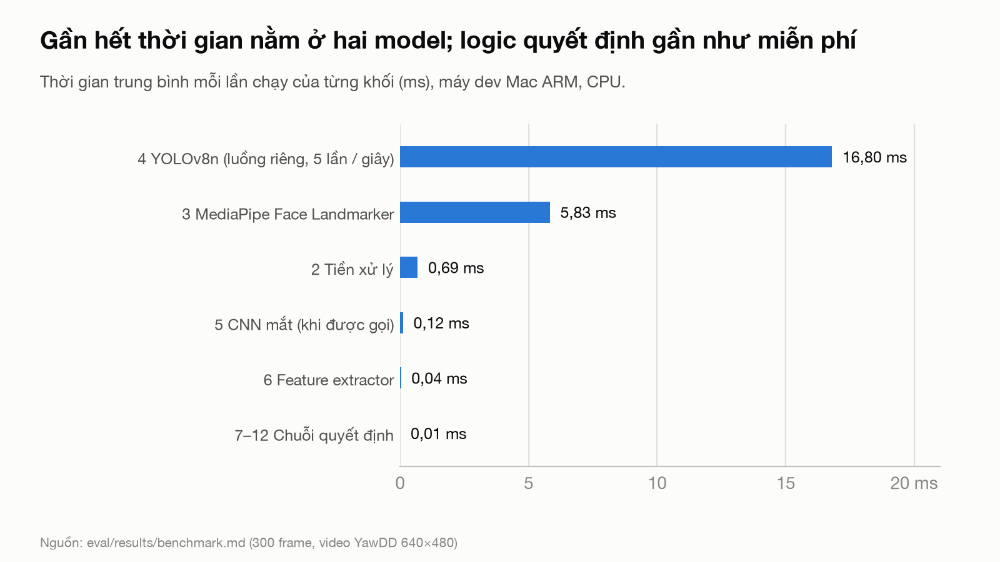
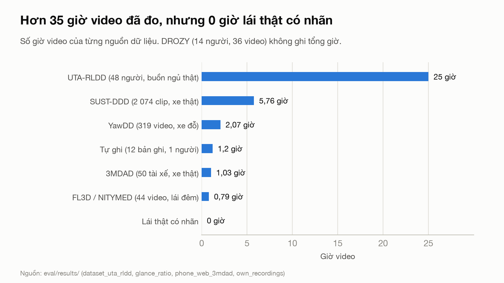
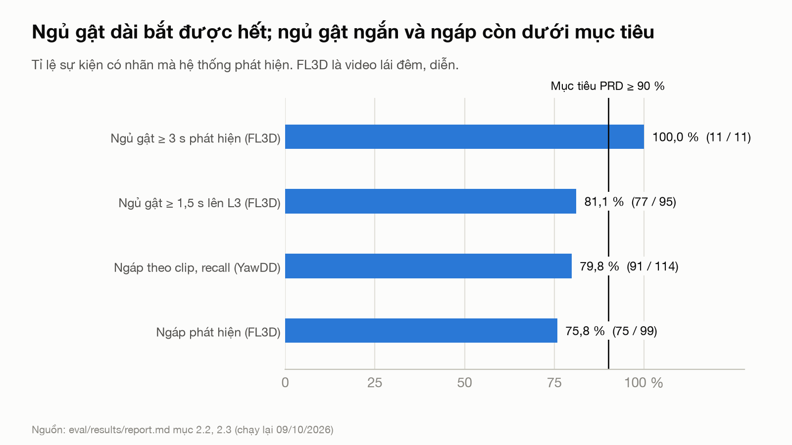
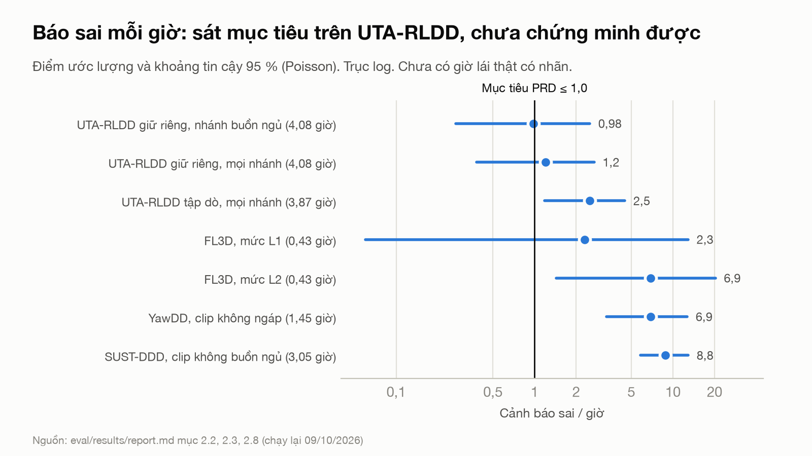
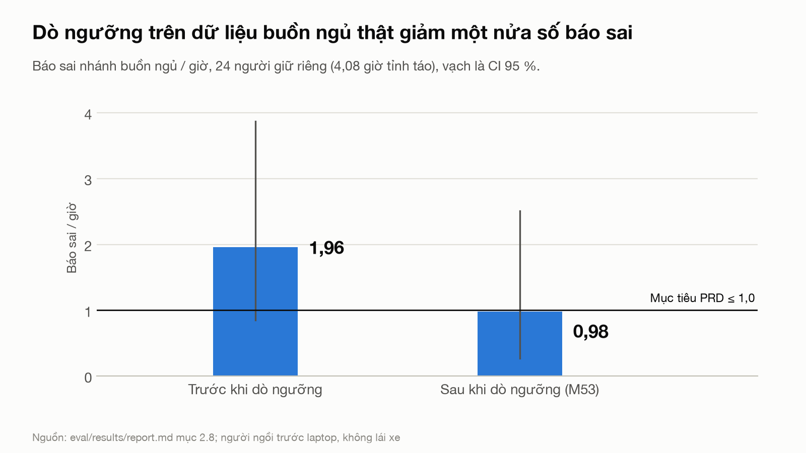
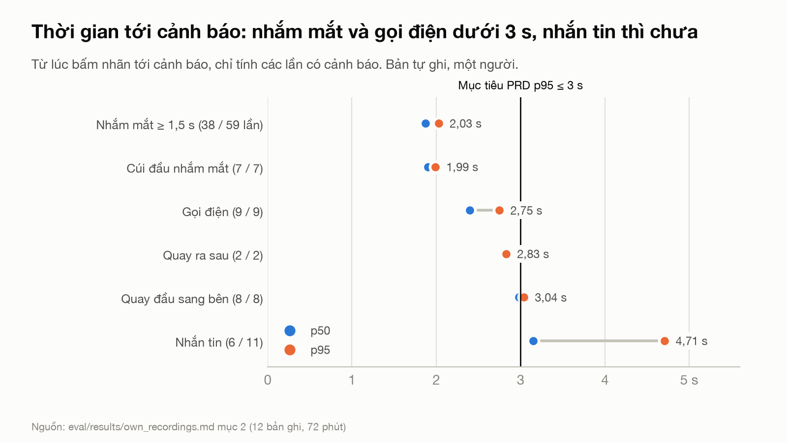
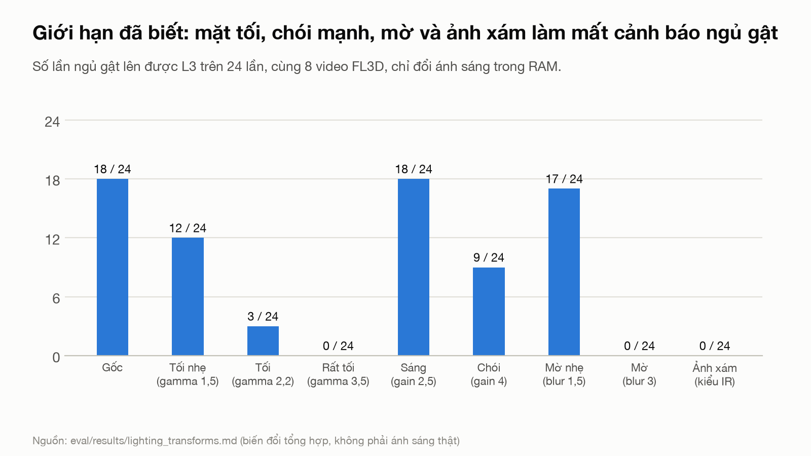
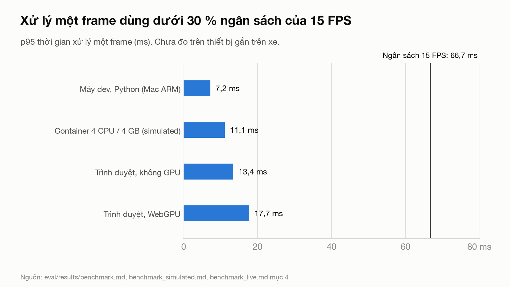
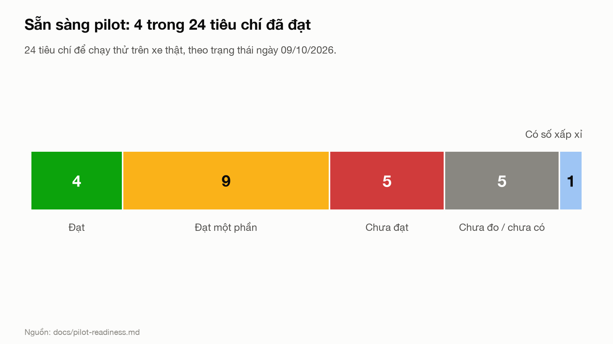

# Số liệu cho pitch deck / presentation

Tổng hợp ngày 09/10/2026, code ở commit `217d43e` (nhánh `DAQuan`, sau M101). Xếp theo 10 slide trong
[`presentation/README.md`](../presentation/README.md). Mỗi số có nguồn trong repo; số ngoài repo nằm riêng ở
[mục 9](#9-số-liệu-bên-ngoài-slide-problem-và-market) kèm đường dẫn.

**Ba luật khi đưa số lên slide** (PRD §4.5, §6, §9):

1. Số báo sai / giờ luôn đi kèm khoảng tin cậy và phạm vi (dataset nào, nhánh nào). Không viết "đạt ≤ 1,0 / giờ".
2. Không claim: đã pilot với tài xế, đã chạy trên xe / thiết bị thật, giảm tai nạn, phát hiện buồn ngủ tự nhiên khi lái.
3. Số `simulated` (container giới hạn) không phải số đo thiết bị. Chỗ nào chưa đo thì ghi "chưa đo".

## 1. Số dùng ngay (chọn 5–7 số cho slide chính)

| Số | Nghĩa | Phải ghi kèm | Nguồn |
|---|---|---|---|
| **0** ảnh rời thiết bị | Chỉ gửi metadata JSON; máy chủ từ chối nội dung giống ảnh | Có test ở cả thiết bị và máy chủ | `tests/test_backend/test_privacy.py` |
| **~152 FPS** | Vòng lặp chính (khối 2–12), p95 7,2 ms / frame | Máy dev Mac ARM 10 nhân, CPU, không GPU | `eval/results/benchmark.md` |
| **30 FPS** giữ 10 phút | Container giới hạn 4 CPU / 4 GB, p95 11,1 ms, RAM đỉnh 597 MB | `simulated`: cận trên, không phải thiết bị | `eval/results/benchmark_simulated.md` |
| **30 FPS** trong trình duyệt | Trang `#/live` (MediaPipe Web + YOLO + Pyodide), cả frame 11–12 ms | Chromium headless trên máy dev | `eval/results/benchmark_live.md` mục 4 |
| **16,7 MB** | Tổng 3 model pretrained (7,4 MB nếu dùng YOLO INT8) | INT8 chưa đo độ chính xác, chưa dùng | `eval/results/quantization.md` |
| **97,6 %** | Precision cảnh báo L3: 83 / 85 cảnh báo đúng | FL3D, video lái đêm, diễn | `eval/results/report.md` mục 2.2 |
| **81,1 %** (77 / 95) | Ngủ gật ≥ 1,5 s lên được L3; ≥ 3 s: 11 / 11 | Mục tiêu PRD ≥ 90 %: chưa đạt | `report.md` mục 2.2 |
| **0,98 / giờ** (CI 95 % 0,27–2,51) | Báo sai nhánh buồn ngủ, 24 người giữ riêng, 4,08 giờ tỉnh táo | Người ngồi trước laptop, không lái; mọi nhánh: 1,2 (0,38–2,7) | `report.md` mục 2.8 |
| **1,96 → 0,98 / giờ** | Báo sai nhánh buồn ngủ giảm một nửa sau khi dò ngưỡng (M53) | Cùng tập giữ riêng; cận trên CI vẫn trên 1,0 | `report.md` mục 2.8 |
| **AUC 0,93** | `drowsy_score` tách video buồn ngủ thật khỏi video tỉnh; cùng người: 23 / 24 có điểm cao hơn khi buồn ngủ | UTA-RLDD, chạy lại 09/10 | `report.md` mục 2.8 |
| **15 / 24** người (62,5 %) | Người buồn ngủ thật có cảnh báo; 12 / 24 lên L3 | Mốc EU DDAW: trung bình > 40 %. Chỉ là số xấp xỉ, không phải phép thử DDAW | `docs/pilot-readiness.md` A4 |
| **1 712** test Python, **293** test frontend | Đều pass (chạy 09/10/2026; thêm 6 xfailed) | | `pytest tests/`, `npm test` |

### Hình có sẵn cho slide

9 hình PNG 1600×900 (16:9) trong [`pitch-deck-charts/`](pitch-deck-charts/), kéo thẳng vào slide được. Mỗi hình có tiêu
đề là kết luận, dòng phạm vi và nguồn. Dựng lại: `.venv/bin/python docs/pitch-deck-charts/build_charts.py` (số nằm
trong script, sửa ở đó khi `eval/results/` đổi).

| Hình | Nói gì | Slide gợi ý |
|---|---|---|
| [01](pitch-deck-charts/01-bao-sai-moi-gio.png) | Báo sai / giờ theo dataset, kèm CI 95 % và mục tiêu 1,0 | Traction |
| [02](pitch-deck-charts/02-truoc-sau-do-nguong.png) | Báo sai giảm một nửa sau khi dò ngưỡng | Traction |
| [03](pitch-deck-charts/03-ti-le-phat-hien.png) | Tỉ lệ phát hiện ngủ gật và ngáp so với mục tiêu 90 % | Traction |
| [04](pitch-deck-charts/04-thoi-gian-toi-canh-bao.png) | Thời gian tới cảnh báo theo hành động so với 3 s | Traction / Demo |
| [05](pitch-deck-charts/05-do-tre-moi-frame.png) | Độ trễ mỗi frame so với ngân sách 15 FPS | Tech Stack |
| [06](pitch-deck-charts/06-thoi-gian-tung-khoi.png) | Thời gian từng khối | Architecture |
| [07](pitch-deck-charts/07-anh-sang.png) | Ánh sáng xấu làm mất cảnh báo ngủ gật | Giới hạn / Ask |
| [08](pitch-deck-charts/08-du-lieu-da-do.png) | Giờ video đã đo theo nguồn, 0 giờ lái thật | Traction / Ask |
| [09](pitch-deck-charts/09-san-sang-pilot.png) | 24 tiêu chí sẵn sàng pilot theo trạng thái | Ask |

Sơ đồ kiến trúc 14 khối có sẵn ở [`architecture_diagram.md`](architecture_diagram.md); UML và user flow ở
[`diagrams/png/`](diagrams/png/).

### Bảng trước / sau tối ưu

| Hạng mục | Trước | Sau | Thay đổi | Nguồn |
|---|---:|---:|---|---|
| Báo sai nhánh buồn ngủ / giờ (UTA-RLDD giữ riêng) | 1,96 | 0,98 | Giảm 50 % (M53) | `report.md` mục 2.8 |
| FAR theo cửa sổ 10 s, mức L1 | 3,9 % | 1,5 % | Giảm 62 % (M53) | `report.md` mục 2.8 |
| Python trong trình duyệt, p50 / frame | 1,97 ms | 0,61 ms | Nhanh hơn 3,2 lần (M49) | `benchmark_web.md` |
| YOLO trong trình duyệt, một lần chạy (WebGPU) | 94,5 ms | 17,0 ms | Nhanh hơn 5,6 lần (M67) | `benchmark_live.md` mục 4 |
| Tuổi kết quả YOLO đang dùng, p50 | 232,6 ms | 67,2 ms | Mới hơn 3,5 lần (M67) | `benchmark_live.md` mục 4 |
| CPU của trang (% một nhân, WebGPU) | 109 | 32 | Giảm 71 % (M67) | `benchmark_live.md` mục 4 |
| Kích thước YOLOv8n (FP32 → INT8) | 12,85 MB | 3,61 MB | Nhỏ hơn 3,6 lần; INT8 chưa dùng | `quantization.md` |

## 2. Slide Problem: vấn đề sản phẩm nhắm tới

Repo không có số thống kê tai nạn; dùng [mục 9](#9-số-liệu-bên-ngoài-slide-problem-và-market). Ba vấn đề của giải
pháp hiện có mà DriverGuard nhắm tới (README, PRD §1): báo sai nhiều nên tài xế tắt đi; không nói rõ khi không quan
sát được; gửi video khuôn mặt lên cloud.

## 3. Slide Solution: sản phẩm làm gì

| Hạng mục | Số |
|---|---|
| Mức cảnh báo | 4 (L0–L3) |
| Tín hiệu buồn ngủ | Nhắm mắt lâu, PERCLOS 60 s, ngáp, gục đầu (trọng số điểm: 40 / 25 / 15 / 20) |
| Tín hiệu mất tập trung | Nhìn khỏi đường, điện thoại (gọi / nhắn) |
| Ngủ gật → L3 | Nhắm mắt ≥ 1,5 s khi xe chạy; ≥ 6 s là "không phản ứng", báo quản lý ngay |
| Nhìn khỏi đường → L2 | ≥ 2,0 s; ≥ 1,5 s khi chạy nhanh; áp dụng từ 5 km/h |
| Điện thoại → L2 | Thấy điện thoại ≥ 60 % thời gian trong 2 s |
| Ngưỡng điểm buồn ngủ | L1 từ 40, L2 từ 70 (thang 0–100); đêm và lái lâu nhân tối đa 1,2 |
| Xe đứng yên | Không cảnh báo (mức tối đa L0) |
| Tạm ngưng giám sát | Mất mặt ≥ 3 s, hoặc mặt quá tối / chói / mờ ≥ 5 s |
| Đăng ký khuôn mặt | ~10 s, khi xe dừng |
| Vai trò người dùng | 4: tài xế, kỹ sư an toàn, quản lý đội xe, quản trị |
| Lưu dữ liệu | Cảnh báo tự xoá sau 60 ngày, tổng kết chuyến sau 365 ngày |
| Máy chủ biết xe mất liên lạc | Trong 90 s (nhịp "còn sống" 30 s) |

Nguồn: `config/thresholds.yaml`, `README.md`, `docs/data-policy.md`.

## 4. Slide Architecture và Tech Stack

| Hạng mục | Số |
|---|---|
| Khối xử lý | 14, chạy theo thứ tự, toàn bộ on-device |
| Model pretrained | 3: MediaPipe Face Landmarker (3,76 MB), YOLOv8n (12,85 MB; INT8 3,61 MB), CNN mắt (0,05 MB). Không train model nào |
| Ngưỡng cấu hình | 349 giá trị trong `config/thresholds.yaml`, 0 hardcode trong logic |
| Một logic, hai nơi chạy | Python trên thiết bị và Pyodide trong trình duyệt (`#/live`) |
| API | 33 route FastAPI |
| Bản deploy | 3 service trên Railway (v1.1, v2.2, v3) |
| LLM | Không dùng |

Thời gian từng khối trên máy dev (`benchmark.md`), ms / frame trung bình:

| Khối | ms | Ghi chú |
|---|---:|---|
| 2 Tiền xử lý | 0,69 | |
| 3 MediaPipe | 5,83 | Chiếm gần hết thời gian một frame |
| 5 CNN mắt | 0,12 | Chỉ chạy khi EAR không tin được |
| 6 Feature | 0,04 | |
| 7–12 Chuỗi quyết định | 0,01 | |
| 4 YOLOv8n | 16,8 | Luồng riêng, 5 lần / giây, không chặn vòng lặp chính |

## 5. Slide Traction, phần độ chính xác

### 5.1 Dữ liệu đã đo

| Dataset | Lượng | Tính chất |
|---|---|---|
| UTA-RLDD | 48 người, 145 video, 25,0 giờ, 2 435 120 frame | Buồn ngủ thật, ngồi trước laptop; chia 24 người dò / 24 người giữ riêng |
| FL3D / NITYMED | 44 video, 47,2 phút, 53 331 frame có nhãn | Lái đêm, diễn |
| YawDD | 319 video, 124 phút, 106 người | Xe đỗ, ban ngày |
| SUST-DDD | 2 074 clip 10 s | Quay trên xe thật |
| 3MDAD | 50 tài xế, 111 017 frame, 1,03 giờ, 16 hành động | Xe thật, ban ngày, diễn |
| DROZY | 14 người, 36 video | Camera cận hồng ngoại, có điểm KSS |
| Ảnh đơn Kaggle | 5 bộ, 14 139 ảnh (7 phép đo) | MRL Eye, yawn-eye, DDD, drowsy-detection, State Farm |
| Tự ghi | 12 bản ghi, 72 phút, 1 người | Chỉ lưu số, không lưu ảnh |
| **Giờ lái thật có nhãn** | **0** | Khoảng trống lớn nhất |

Tổng: 11 dataset công khai và một bộ tự ghi, hơn 35 giờ video.

### 5.2 Theo từng ảnh (`report.md` mục 2.1)

| Tín hiệu | Dataset | Ảnh | Accuracy | Precision | Recall | FPR |
|---|---|---:|---:|---:|---:|---:|
| Mắt nhắm (CNN) | MRL Eye | 4 000 | 99,4 % | 99,8 % | 99,0 % | 0,2 % |
| Mắt nhắm (CNN) | MRL Eye full, test | 3 223 | 95,4 % | 91,4 % | 100 % | 8,9 % |
| Mắt nhắm (CNN) | yawn-eye, test | 218 | 88,1 % | 97,7 % | 78,0 % | 1,8 % |
| Ngáp (MAR) | yawn-eye, test | 215 | 91,6 % | 100 % | 83,0 % | 0,0 % |
| Điện thoại (YOLOv8n) | State Farm | 2 000 | 51,0 % | 95,5 % | 2,1 % | 0,1 % |

Số MRL Eye lạc quan: CNN được học trên chính bộ này. State Farm quay từ bên hông, sai góc camera.

### 5.3 Trên video (`report.md` mục 2.2, 2.3)

| Phép đo | Kết quả | Dataset |
|---|---|---|
| Mắt nhắm theo frame | Precision 71,2 %, recall 87,3 %, FPR 8,1 % | FL3D |
| Mắt nhắm sâu theo frame | Precision 89,3 %, recall 88,9 %, FPR 2,4 % | FL3D |
| Ngáp theo frame | Precision 97,9 %, recall 88,7 %, FPR 0,3 % | FL3D |
| Ngủ gật ≥ 1,5 s lên L3 | 77 / 95 (81,1 %) | FL3D |
| Ngủ gật ≥ 3 s phát hiện | 11 / 11 | FL3D |
| Ngáp phát hiện | 75 / 99 (75,8 %), trễ p50 1,56 s | FL3D |
| Ngáp theo clip | Precision 100 %, recall 79,8 %, F1 0,89 | YawDD |
| Cảnh báo L3 đúng | 83 / 85 (97,6 %) | FL3D |

### 5.4 Báo sai mỗi giờ (mục tiêu PRD ≤ 1,0 / giờ, tính mọi cảnh báo)

| Dataset | Giờ tỉnh táo | Báo sai / giờ (CI 95 %) | Phạm vi |
|---|---:|---:|---|
| UTA-RLDD, giữ riêng | 4,08 | **0,98 (0,27–2,51)** | Chỉ nhánh buồn ngủ, sau 30 s đầu |
| UTA-RLDD, giữ riêng | 4,08 | **1,2 (0,38–2,7)** | Mọi nhánh, cả video: số so được với PRD |
| UTA-RLDD, tập dò | 3,87 | 2,5 (1,18–4,5) | Mọi nhánh, cả video |
| FL3D | 0,43 | L1 2,3 (0,06–12,9); L2 6,9 (1,43–20,3); L3 2,3 (0,06–12,9) | Theo mức |
| YawDD | 1,45 | 6,9 (3,31–12,7) | Clip không ngáp |
| SUST-DDD | 3,05 | 8,8 (5,83–12,9) | Clip không buồn ngủ |
| DROZY | 2,33 | 0 lần trên 15 video tỉnh | Nhánh buồn ngủ |

Trên UTA-RLDD cả 4 lần báo sai là của 1 người trong 24, trên một video quay 12 FPS. Nguồn báo sai chính ở YawDD và
SUST là `off_road` khi tài xế quay đầu thật (SUST: 25 / 27). Kết luận dùng trên slide: **chưa đạt**, điểm ước lượng
tốt nhất sát 1,0 nhưng cận trên CI còn trên 1,0 ở mọi cách đếm.

### 5.5 Thời gian tới cảnh báo (mục tiêu PRD p95 ≤ 3 s)

Bản tự ghi, một người, nhãn bấm phím (`eval/results/own_recordings.md`):

| Hành động | Có cảnh báo | Trễ p50 | Trễ p95 |
|---|---:|---:|---:|
| Nhắm mắt ≥ 1,5 s | 38 / 59 (64 %) | 1,87 s | 2,03 s |
| Cúi đầu nhắm mắt | 7 / 7 | 1,90 s | 1,99 s |
| Gọi điện | 9 / 9 | 2,40 s | 2,75 s |
| Nhắn tin | 6 / 11 (55 %) | 3,15 s | 4,71 s |
| Quay đầu sang bên | 8 / 8 | 2,98 s | 3,04 s |
| Quay ra sau | 2 / 2 | 2,83 s | 2,83 s |
| Nhìn xuống điện thoại / bảng điều khiển | 0 / 13 | – | – |

Trễ chỉ tính trên các lần có cảnh báo, chưa gồm thời gian tới loa.

### 5.6 Giới hạn nên nói thẳng

| Giới hạn | Số |
|---|---|
| Mặt rất tối (độ sáng < 60) | Recall mắt nhắm 40,3 % so với 92,6 % ở mức sáng 60–100 (FL3D) |
| Ảnh xám kiểu hồng ngoại | Ngủ gật lên L3: 0 / 24 so với 18 / 24 ở ảnh gốc (`lighting_transforms.md`) |
| Điện thoại, 3MDAD | Recall ~11 % trên chuỗi diễn 3–5 s, precision 99–100 % (`phone_web_3mdad.md`) |
| Mắt liếc xuống, đầu thẳng | Không bắt được: 0 / 13 lần |
| Thiết bị chậm 10–12 FPS | Báo sai không tăng: 0,72–0,93 / giờ so với 0,93 ở 30 FPS (`fps_low_uta_rldd.md`) |
| Cá nhân hoá | Chưa có số nào cho thấy giảm báo sai: 9 / 9 / 9 lần trên 7,94 giờ |
| Trạng thái im lặng mức Cao | Còn 3 trong 24 dòng FMEA: app bị hệ điều hành dừng, kính râm, CNN mắt khi mặt tối |

## 6. Slide Traction, phần hiệu năng

| Phép đo | Số | Điều kiện | Nguồn |
|---|---|---|---|
| FPS vòng lặp chính | 151,8 (FP32) / 152,2 (INT8) | Máy dev, chạy liền không theo nhịp camera | `benchmark.md` |
| Latency / frame | p50 6,5 ms, p95 7,2 ms | Máy dev, 300 frame | `benchmark.md` |
| Chạy 10 phút, máy dev | 29,9 FPS, CPU 54 % một nhân, RAM đỉnh 601 MB | Nhịp camera 30 FPS | `benchmark_simulated.md` |
| Chạy 10 phút, 4 CPU / 4 GB | 29,9 FPS, p95 11,1 ms, CPU 93 % một nhân, RAM đỉnh 597 MB | `simulated` | `benchmark_simulated.md` |
| Chạy 5 phút, 4 CPU, YOLO INT8 | 30,0 FPS, CPU 57 % một nhân | `simulated` | `benchmark_simulated.md` |
| Trình duyệt, không GPU | 29,65 FPS, cả frame 11,0 / 13,4 ms (p50 / p95) | Chromium headless | `benchmark_live.md` |
| Trình duyệt, WebGPU | 29,69 FPS, YOLO 17 ms (trước M67: 94,5 ms), CPU trang 32 % (trước: 109 %) | Apple M5 | `benchmark_live.md` |
| Khởi động trang | 2,1–2,2 s tới frame đầu | Cache trống | `benchmark_live.md` |
| Python trong trình duyệt | p50 0,61 ms / frame (trước M49: 1,97 ms, nhanh hơn 3,2 lần) | Pyodide dưới Node | `benchmark_web.md` |
| Trên hub gắn trên xe | **Chưa đo** | Không có thiết bị | `pilot-readiness.md` C1 |

So với mục tiêu: CLAUDE.md ≥ 15 FPS và PRD NFR-2 (p95 ≤ 200 ms, ≥ 10 FPS) đều đạt trên máy dev và `simulated`.

## 7. Slide Traction, phần khối lượng công việc

| Hạng mục | Số |
|---|---|
| Thời gian | 12/09 – 09/10/2026 |
| Mốc roadmap | 102 (M0–M101) |
| Commit | 135 |
| Code | `edge_agent` 9 401 dòng, `backend` 2 611, `tools` 11 199, `frontend` ~13 900 (TS / TSX) |
| Test | `tests/` 18 365 dòng; 1 712 test Python pass, 6 xfailed; 293 test frontend pass (25 file) |
| Test hồi quy trên trace trong CI | 36 video, 17 763 frame |
| Báo cáo đánh giá | 32 file trong `eval/results/` |
| Bản phát hành | v1.1, v2.2, v3 đã deploy; v4 (từ M70) chưa deploy |
| Tiêu chí sẵn sàng pilot | 24: 4 đạt, 9 đạt một phần, 5 chưa đạt, 5 chưa đo, 1 có số xấp xỉ |
| Người dùng thật, phản hồi | **0**: chưa tổ chức buổi demo / khảo sát 10 người (mục tiêu ≥ 9 / 10 hiểu đúng 3 trạng thái) |

## 8. Bảng mục tiêu so với hiện có (một slide "trung thực")

| Mục tiêu | Ngưỡng | Hiện có | Trạng thái |
|---|---|---|---|
| Ảnh rời thiết bị | 0 | 0, có test | Đạt |
| FPS | ≥ 15 | ~152 máy dev, 30 `simulated` | Đạt trên máy dev, chưa đo trên thiết bị |
| Báo sai / giờ | ≤ 1,0 kể cả cận trên CI | 1,2 (0,38–2,7), không phải dữ liệu lái xe | Chưa đạt |
| Bắt ngủ gật ≥ 1,5 s | ≥ 90 % | 81,1 % | Chưa đạt |
| Thời gian tới cảnh báo | p95 ≤ 3 s | 2,03 s nhắm mắt; 2,75 s gọi điện; 4,71 s nhắn tin | Một phần |
| Độ nhạy khi buồn ngủ thật | > 40 % (mốc EU) | 62,5 % (CI 90 % 45,8–76,7), xấp xỉ | Trên mốc, chưa phải phép thử chuẩn |
| Hiểu cảnh báo | ≥ 9 / 10 người | Chưa tổ chức | Chưa đo |
| Mất liên lạc | Biết trong 90 s | Có, đã test | Đạt |

## 9. Số liệu bên ngoài (slide Problem và Market)

Lấy từ tìm kiếm web ngày 09/10/2026, **chưa đọc văn bản gốc**: mở từng nguồn kiểm lại trước khi đưa lên slide.

| Số | Nội dung | Nguồn |
|---|---|---|
| 1,19 triệu người / năm | Chết vì tai nạn giao thông toàn cầu; hơn 3 200 người / ngày; nguyên nhân tử vong hàng đầu ở nhóm 5–29 tuổi | [WHO, Global status report on road safety 2023](https://www.who.int/publications/i/item/9789240086517) |
| 16 938 vụ, 9 549 người chết, 11 224 người bị thương | Việt Nam, 11 tháng đầu 2025 (giảm 22,19 % số vụ, 6,39 % số người chết so với cùng kỳ 2024) | [lsvn.vn, số của Ủy ban ATGT Quốc gia](https://lsvn.vn/11-thang-nam-2025-tngt-duong-bo-giam-hon-23-a166350.html) |
| 633 so với hơn 6 300 người chết | Mỹ, 2023: số chính thức của NHTSA về lái xe buồn ngủ so với ước tính của GHSA (gấp 10 lần, vì buồn ngủ không để lại bằng chứng xét nghiệm được) | [GHSA, Wake Up Call 2026 Update](https://www.ghsa.org/sites/default/files/2026-02/Wake_Up_Call_2026_Update.pdf) |
| ~205 000–207 000 xe | Xe kinh doanh vận tải ở Việt Nam phải lắp camera theo Nghị định 10/2020 (xe khách từ 9 chỗ, container, đầu kéo); khoảng 150 000 xe đã lắp tính tới 04/2022 | [VnExpress](https://vnexpress.net/200-000-xe-khach-xe-container-se-phai-lap-camera-4261544.html), [lsvn.vn](https://lsvn.vn/ca-nuoc-co-103000-xe-kinh-doanh-van-tai-da-lap-camera-giam-sat1642928119-a114541.html) |
| 1,4–1,9 tỷ USD (2025) | Thị trường driver monitoring system toàn cầu, tăng ~10–12,5 % / năm; dự báo 2030 lệch nhau nhiều giữa các hãng (2,8 đến 5,6 tỷ USD; 18,9 tỷ nếu gộp cả giám sát hành khách) | [MarketsandMarkets](https://www.marketsandmarkets.com/Market-Reports/driver-monitoring-system-market-45988827.html), [Allied Market Research](https://alliedmarketresearch.com/press-release/driver-monitoring-systems-market.html) |
| EU 2021/1341 và 2023/2590 | Quy định bắt buộc cảnh báo buồn ngủ (DDAW) và mất tập trung (ADDW) trên xe mới ở EU; team đã đọc văn bản gốc | [EUR-Lex 2021/1341](https://eur-lex.europa.eu/legal-content/EN/TXT/HTML/?uri=CELEX:32021R1341), [2023/2590](https://eur-lex.europa.eu/legal-content/EN/TXT/HTML/?uri=CELEX:32023R2590) |

Chưa tìm được: tỉ lệ tai nạn do buồn ngủ / mất tập trung ở Việt Nam; giá thiết bị DMS của đối thủ; quy mô thị trường
Việt Nam tính bằng tiền. Ba chỗ này để trống hoặc ghi rõ là ước tính của team.

## 10. Slide Team và Ask

| Hạng mục | Số / nội dung |
|---|---|
| Team | 4 người, AI20K Build Phase Cohort 4, VinUni: @DQQuan-VinAI, @hddung-vinai, @Yuhnguyn, @kelsingo |
| Giai đoạn hiện tại | Giai đoạn 0–1 trong 5 giai đoạn: bản web mô phỏng, đo trên dataset công khai |
| Cần để sang pilot | Thiết bị gắn trên xe và tốc độ thật; ≥ 3,7 giờ lái tỉnh táo có nhãn không lần báo sai nào để chứng minh ≤ 1,0 / giờ; pilot 1–3 xe, mỗi xe ≥ 4 giờ, có người ngồi cạnh |
| Việc mở còn lại | Buổi 10 người kiểm tra hiểu cảnh báo; hướng mắt (liếc xuống); kính râm; CNN mắt khi tối |

Nguồn: `README.md` mục Team, `docs/pilot-readiness.md` mục 1–2.
